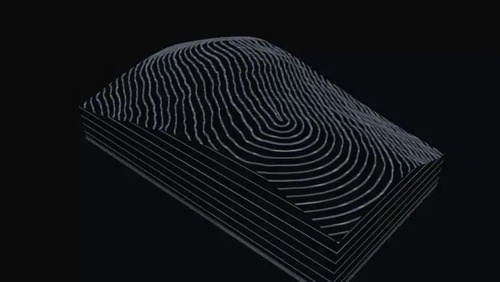
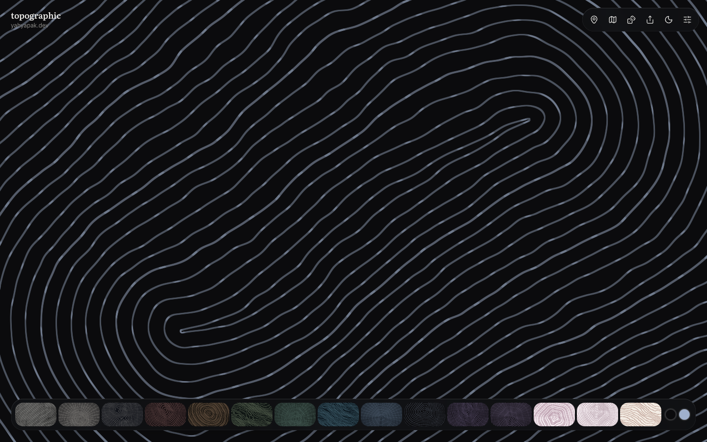
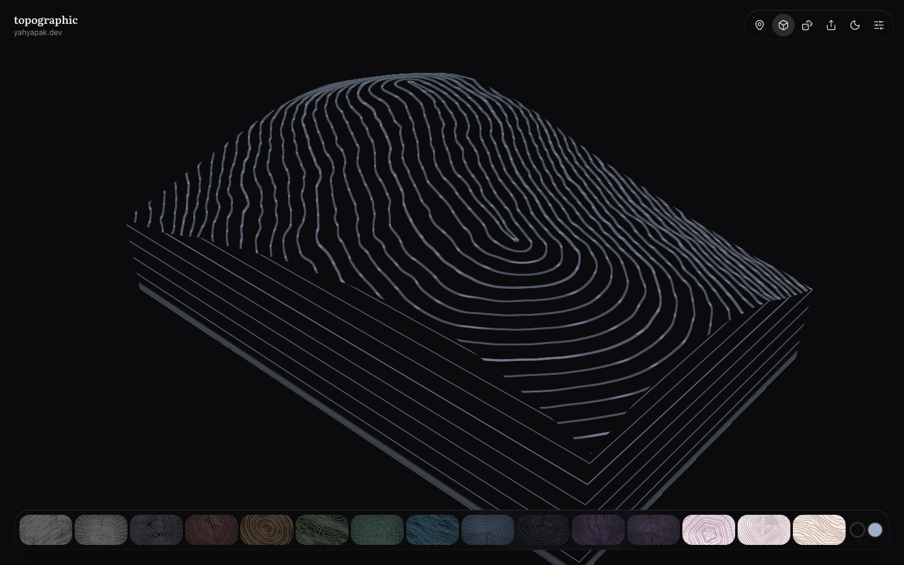
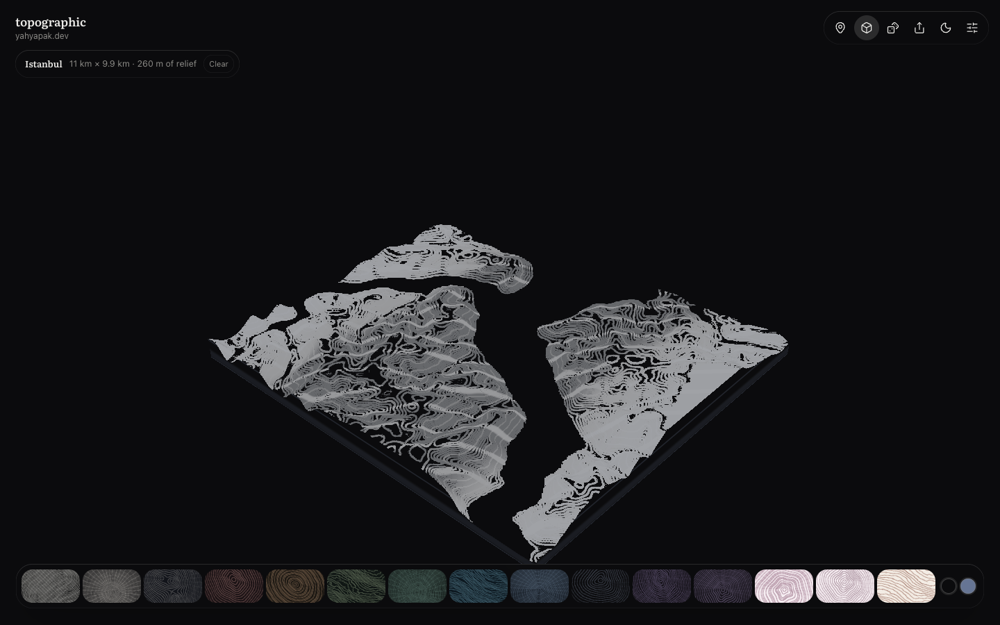
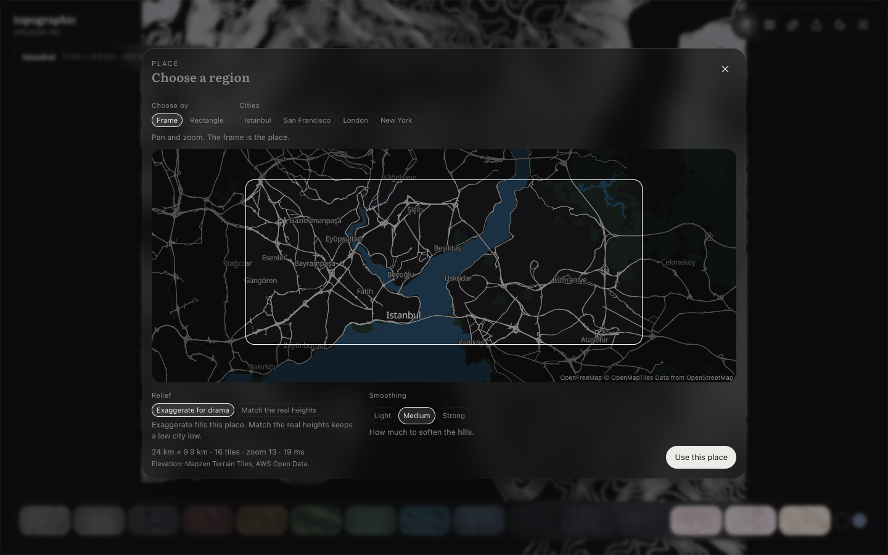

<p align="center"></p>

<h1 align="center">topographic</h1>



## What is topographic

topographic is a JavaScript library that draws topographic backgrounds: animated contour lines, like those on a topographic map, behind a web page.

It draws them as a flat 2D map, or as that same map lifted into a 3D terrain with a moving camera. From the 3D view it records a short MP4 or WebM clip. And it can draw a real place: give it a grid of real elevation, and the contour lines follow the ground.

| 2D | 3D |
|---|---|
|  |  |

You choose a terrain style and set options for the lines, the terrain, the motion and the layout. It follows light and dark mode, pauses when nobody can see it, holds still for people who prefer less motion, and shows a plain colour where WebGL isn't available. You can try it in the [playground](https://yahyabedirhan.github.io/topographic/).

## How it works

1. **Pick a style:** dunes, granite, a gentle summit, a long ridge and more.
2. **Tune it** with a few readable settings for the lines, the terrain, the motion and the layout.
3. **Choose 2D or 3D.** The same seed and settings give the same map in both.
4. **Drop it in** as a web component, a React component or one JavaScript call.

### One terrain, two views


The 2D map and the 3D terrain run the same GLSL contour field and line painter. In 3D the field also lifts a mesh, and a camera moves around it.

### From a real place to a terrain


In the playground, a worker turns the framed map area into a smoothed 0..1 elevation grid. `setHeightfield()` then draws it as the 2D map or the 3D terrain.

## Install

On npm: [`topographic`](https://www.npmjs.com/package/topographic) for the core and the web component, and [`topographic-react`](https://www.npmjs.com/package/topographic-react) for React. The 3D view, `record()` and `setHeightfield()` are in the packages from 0.2.0.

```sh
npm install topographic
```

**JavaScript:**

```js
import { createTopographicBackground } from 'topographic';

const topographic = createTopographicBackground(document.querySelector('#hero'), {
  style: 'long-ridge',
  mode: '3d',
  camera: { motion: 'orbit' },
});
topographic.update({ terrain: { peaks: 3 } });
```

**Web component:**

```html
<script type="module">import 'topographic/element';</script>

<topographic-bg style-name="long-ridge" mode="3d" elevation="0.7" camera-motion="orbit"></topographic-bg>
```

**React** (`npm install topographic-react`):

```tsx
import { TopographicBackground } from 'topographic-react';

<TopographicBackground styleName="long-ridge" mode="3d" camera={{ motion: 'orbit' }} style={{ height: '100vh' }} />
```

Leave out `mode` for the 2D map, which is the default.

## 3D and video

Set `mode: '3d'` to lift the map into a terrain. A few settings shape it:

- `elevation`: how tall the terrain is, from flat (0) to tall (1).
- `extent`: `block`, a tabletop with layer lines on its cut sides, or `endless`, terrain that runs past the view.
- `detail`: the mesh resolution.
- `camera`: `azimuth`, `elevation` and `radius` place the camera, and `motion` moves it: `still`, `orbit`, `push`, `flyover` or `drone`.

`record()` renders a clip of the 3D view with a moving camera, and resolves to an MP4 or WebM `Blob`. It draws off-screen, so the live canvas keeps its size. It needs a browser that can encode video with WebCodecs.

```js
const clip = await topographic.record({ seconds: 6, motion: 'orbit', format: 'mp4' });
```

On the web component, the instance is `element.topographic`. In React, `onReady` gives it to you.

`setHeightfield({ samples, size, aspect })` replaces the procedural terrain with your own square elevation grid, values 0 to 1. `setHeightfield(null)` brings the style back.

The [guide](docs/guide.md#three-dimensions) has the full table of 3D settings, with their attributes, ranges and defaults, and every option of `record()`.

## Real places



The place picker in the [playground](https://yahyabedirhan.github.io/topographic/) turns a part of the real world into this terrain. The npm packages don't include it: they take the result through `setHeightfield()`.



Click the map-pin **Place** button at the top right. Pan and zoom the map, or pick one of the city pills under it, so the frame covers the area you want, up to 300 km on a side. Then click **Apply**. **Generated** goes back to the generated terrain. The Elevation slider under Tune → 3D sets the height, the same as for generated terrain. Click the 3D button, or add `mode=3d` to the URL, for the terrain view. The elevation comes from Mapzen Terrain Tiles on AWS Open Data, so the picker needs a network connection.

The [region notes](docs/prototypes/region/README.md) list the URL options and the decisions behind the picker.

## Styles


Seven styles, three presets, and the same terrain every time you use the same `seed`. The [guide](docs/guide.md#the-styles-image) lists the settings behind each tile.

## The playground


The [playground](https://yahyabedirhan.github.io/topographic/) is the easiest way to find a background you like. The page itself is the preview: pick a look from the dock at the bottom, move the sliders under **Tune**, then export the result as a link, HTML, React or JSON, a PNG or a 3D video clip. Your settings live in the URL, so a link brings the same background back. The 3D button shows the same settings as a terrain, and **Place** draws a real place.

It works for agents too. It serves plain-text docs at `/llms.txt`, and in browsers with [WebMCP](https://github.com/webmachinelearning/webmcp) an agent can change the settings, get the embed code, take a screenshot, record a 3D clip and choose a real place.

## How the pieces fit

### Library architecture


Every wrapper calls one API, and one renderer draws 2D or 3D from the same resolved settings. `record()` turns the 3D view into an MP4 or WebM clip.

## Learn more

The [guide](docs/guide.md) covers the rest: every setting with its range, the 3D settings, theming and CSS variables, PNG and video export, performance and accessibility, server rendering and Next.js, the WebMCP tools, and troubleshooting. The [design](docs/low-level-design.md) explains how the pieces fit and why.

## Build from source

You need Node.js 20 or later.

```sh
npm install
npm run dev        # the playground, live
npm test           # unit tests
npm run build      # packages and the playground
npm run smoke      # headless Chrome checks (needs Chrome; set CHROME=/path/to/chrome)
```

The shader is ported from the maintainer's personal website prototype. The architecture was inspired by [Paper Shaders](https://github.com/paper-design/shaders).

## Licence

MIT. See [LICENSE](LICENSE).
