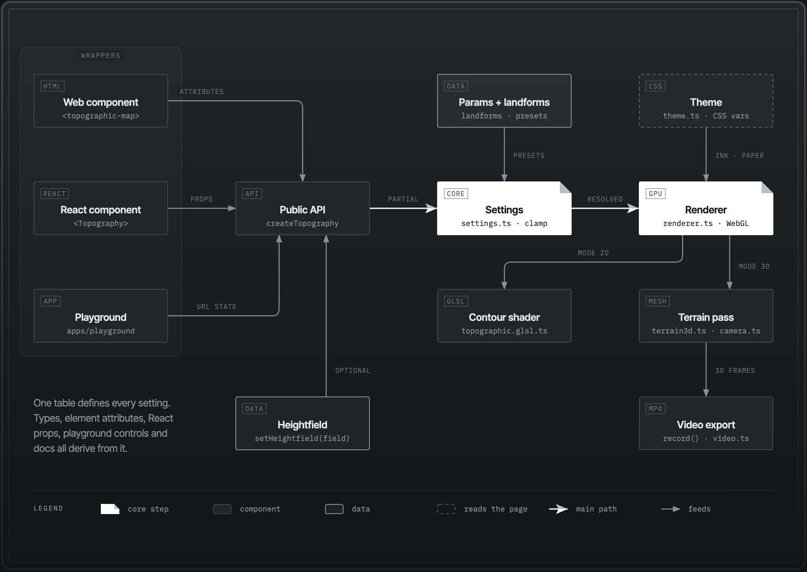

<p align="center"></p>

<h1 align="center">topography.js</h1>


## What is topography.js

topography.js is a JavaScript package that draws animated contour lines, like those on a topographic map, as the background of a web page.

It renders the lines with one WebGL shader. You choose a terrain style and set options for the lines, the terrain, the motion and the layout. You can try the options in the [playground](https://yahyabedirhan.github.io/topography/).

## How it works

1. **Pick a style:** dunes, granite, a gentle summit, a long ridge and more.
2. **Tune it** with a few readable settings for the lines, the terrain, the motion and the layout.
3. **Give it your colours.** It follows light and dark mode.
4. **Drop it in** as a web component, a React component or one JavaScript call.

It pauses when nobody can see it, holds still for people who prefer less motion, and shows a plain colour where WebGL isn't available.

## Install

On npm: [`topography.js`](https://www.npmjs.com/package/topography.js) for the core and the web component, and [`topography-react`](https://www.npmjs.com/package/topography-react) for React.

```sh
npm install topography.js
```

**Web component:**

```html
<script type="module">import 'topography.js/element';</script>

<topography-bg style-name="dunes" line-count="30"></topography-bg>
```

**React** (`npm install topography-react`):

```tsx
import { Topography } from 'topography-react';

<Topography styleName="granite" terrain={{ roughness: 0.3 }} style={{ height: '100vh' }} />
```

**JavaScript:**

```js
import { createTopography } from 'topography.js';

const topography = createTopography(document.querySelector('#hero'), { style: 'gentle-summit' });
topography.update({ terrain: { peaks: 3 } });
```

## Styles


Seven styles, three presets, and the same terrain every time you use the same `seed`. The [guide](docs/guide.md#the-styles-image) lists the settings behind each tile.

## The playground

The [playground](https://yahyabedirhan.github.io/topography/) is the easiest way to find a background you like. The page itself is the preview: pick a preset, move the sliders, then copy the result as HTML, React or JavaScript, or download it as a PNG. Your settings live in the URL, so a link brings the same background back.

It works for agents too. It serves plain-text docs at `/llms.txt`, and in browsers with [WebMCP](https://github.com/webmachinelearning/webmcp) an agent can change the settings and get the embed code itself.

## How the pieces fit

### Library architecture



Everything goes through one API, and one table defines every setting.

## Learn more

The [guide](docs/guide.md) covers the rest: every setting with its range, theming and CSS variables, PNG export, performance and accessibility, server rendering and Next.js, the WebMCP tools, and troubleshooting. The [design](docs/low-level-design.md) explains how the pieces fit and why.

## Build from source

You need Node.js 20 or later.

```sh
npm install
npm run dev       # the playground, live
npm test          # unit tests
npm run build     # packages and the playground
npm run smoke     # headless Chrome checks (needs Chrome; set CHROME=/path/to/chrome)
```

The shader is ported from the author's personal website prototype. The architecture was inspired by [Paper Shaders](https://github.com/paper-design/shaders).

## Licence

MIT. See [LICENSE](LICENSE).
