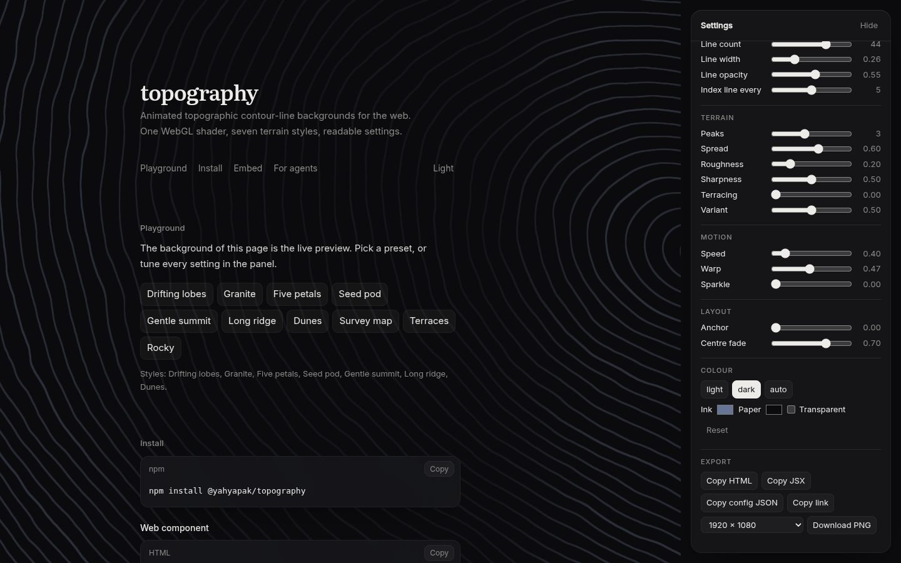

<p align="center"></p>

<h1 align="center">topography</h1>

<p align="center">
  <a href="https://www.npmjs.com/package/@yahyapak/topography"></a>
  <a href="https://www.npmjs.com/package/@yahyapak/topography-react"></a>
</p>

<p align="center"><strong><a href="https://yahyabedirhan.github.io/topography/">Try it in the playground →</a></strong></p>



## What is topography

topography draws animated contour lines, like a topographic map, as a background for your website.

A plain background is quiet but flat, and a video or image is heavy and never quite fits. topography is one small WebGL shader that draws soft, slowly moving terrain behind your content. You pick a terrain style, tune it with a few readable settings, and it fits any size of screen.

On npm: [`@yahyapak/topography`](https://www.npmjs.com/package/@yahyapak/topography) (core and the web component) and [`@yahyapak/topography-react`](https://www.npmjs.com/package/@yahyapak/topography-react) (React).

## How it works

1. **Pick a style**, the shape of the terrain: dunes, granite, a gentle summit, a long ridge and more.
2. **Tune it** with readable settings in four groups: lines, terrain, motion and layout. Out-of-range values are clamped.
3. **Give it colours.** Ink and paper come from your settings or from CSS variables, and follow light and dark mode.
4. **Drop it in** as a web component, a React component or one JavaScript call. The same `seed` gives you the same terrain every time.

It pauses when it's off-screen or the tab is hidden, shows a still frame for people who prefer reduced motion, and falls back to the paper colour where WebGL isn't available.

## Quick start

```sh
npm install @yahyapak/topography
```

**Web component:**

```html
<script type="module">import '@yahyapak/topography/element';</script>

<topography-bg style-name="dunes" line-count="30"></topography-bg>
```

**React** (`npm install @yahyapak/topography-react`):

```tsx
import { Topography } from '@yahyapak/topography-react';

<Topography styleName="granite" terrain={{ roughness: 0.3 }} style={{ height: '100vh' }} />
```

**Vanilla JavaScript:**

```js
import { createTopography } from '@yahyapak/topography';

const topography = createTopography(document.querySelector('#hero'), { style: 'gentle-summit' });
topography.update({ terrain: { peaks: 3 } });
```

## Styles and presets


There are seven styles: **drifting lobes, granite, five petals, seed pod, gentle summit, long ridge** and **dunes**. Presets are ready-made starting points on top of them, like **Survey map**, **Terraces** and **Rocky**.

The image shows all of them in dark mode, frozen at 4 seconds. The first ten tiles are the styles and presets by name. The last six are a style with a different seed and a setting or two changed:

| Tile | Settings |
| --- | --- |
| Twin peaks | `drifting-lobes`, seed 7, peaks 2, spread 1 |
| Fine lines | `drifting-lobes`, seed 21, line count 48 |
| Scree | `granite`, seed 3, roughness 0.6 |
| Bloom | `five-petals`, seed 12, line count 42, variant 0.9 |
| Wide dunes | `dunes`, seed 5, line count 16, line width 0.4 |
| Plateau | `seed-pod`, seed 9, terracing 0.6 |

So the shapes read at this size, every tile also centres the summit (`layout.anchor` 1), turns off the centre fade (`layout.fade` 0) and uses brighter, slightly thicker lines: line opacity 0.85, line width 0.4 and ink `#9fb0cc`. `node scripts/styles-grid.mjs` renders the image again.

## The playground

The playground is the project's own page, live at [yahyabedirhan.github.io/topography](https://yahyabedirhan.github.io/topography/). The page background is the live preview: pick a preset, move the sliders, and copy the result as HTML, React, vanilla JS or a config JSON, or download it as a PNG up to 4K. The settings live in the URL, so a link brings the same background back.

```sh
npm install
npm run dev
```

## Built for agents too

The playground serves plain-text docs at `/llms.txt` and `/llms-full.txt`, plus markdown pages for install, API and every parameter. These are generated from the same table the code uses, so they can't drift.

In browsers with [WebMCP](https://github.com/webmachinelearning/webmcp), the page also registers tools, so an agent can list styles, read and change the settings, randomize, take a screenshot and get embed code without clicking around.

## Learn more

The [guide](docs/guide.md) covers the rest: every API, every setting with its range, theming and CSS variables, the seed, PNG export, performance and accessibility, fallbacks, server rendering and Next.js, the WebMCP tools, and troubleshooting. The [design](docs/low-level-design.md) explains how the pieces fit and why.

## Build from source

You need Node.js 20 or later.

```sh
npm install
npm test          # unit tests
npm run build     # packages and the playground
npm run smoke     # headless Chrome checks (needs Chrome; set CHROME=/path/to/chrome)
```

The shader is ported from the author's personal website prototype, where every style renders the same as the original. The architecture was inspired by [Paper Shaders](https://github.com/paper-design/shaders).

## Licence

MIT. See [LICENSE](LICENSE).
