<p align="center">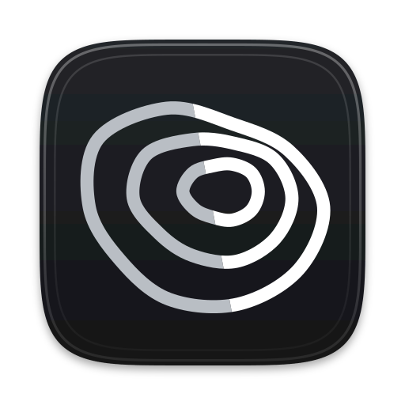</p>

<h1 align="center">topographic</h1>

<p align="center">Animated topographic maps for web backgrounds, rendered with WebGL in 2D and 3D.</p>

<p align="center"><a href="https://topographic.yahyapak.dev/"><b>Open the playground</b></a> · <a href="#install">Install</a> · <a href="docs/guide.md">Guide</a></p>

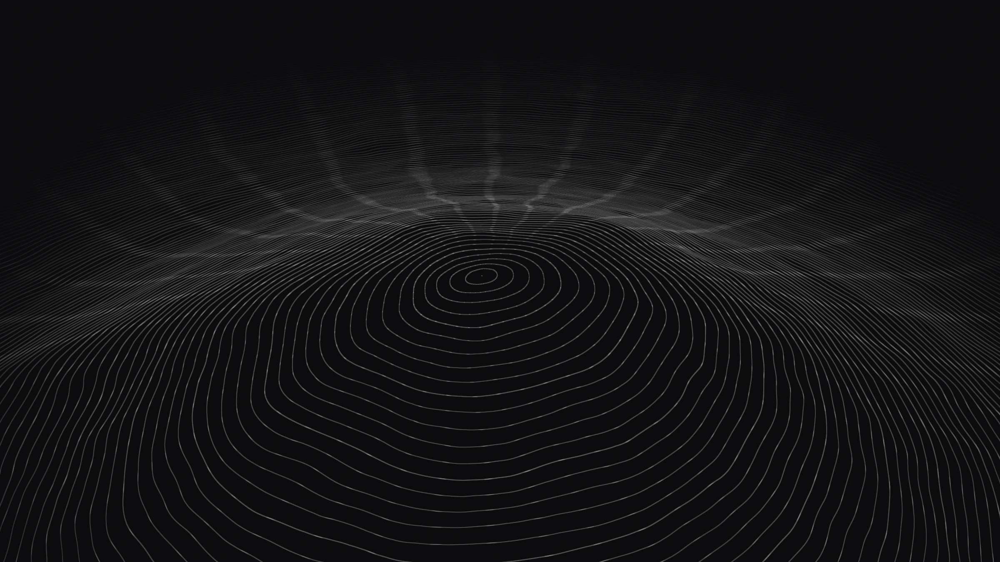

topographic draws moving contour lines, like the lines on a hiking map, behind a web page. It can show them flat (2D) or as a landscape (3D). The landscape can be made up, or it can come from a real place. The npm package has no dependencies. It works in plain HTML and in React. In the [playground](https://topographic.yahyapak.dev/), you change the settings and export code, PNG or video.

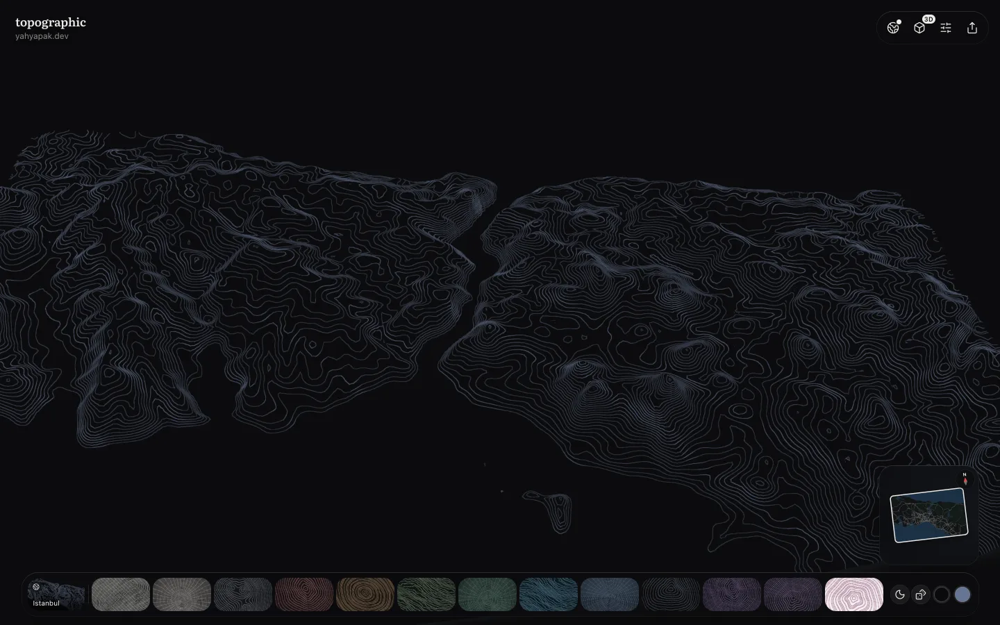

## Examples

You can change the shape of the land, the lines, the colours and the motion. There is no limit to the looks you can make. The same settings always give the same result.

| | | |
|---|---|---|
| 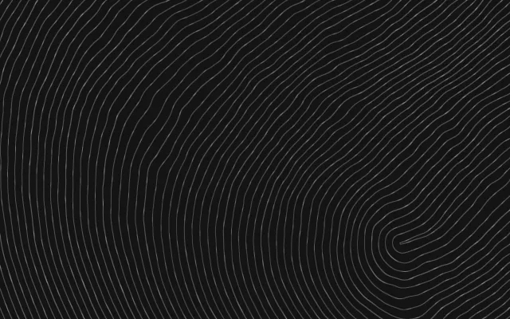 | 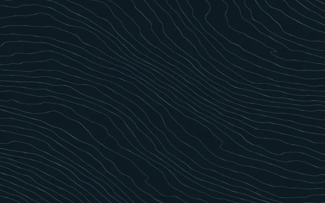 | 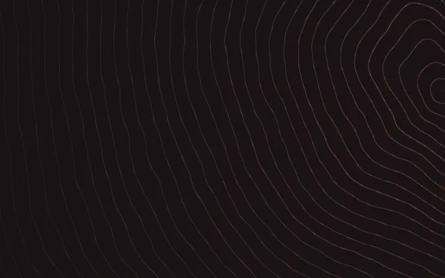 |
| 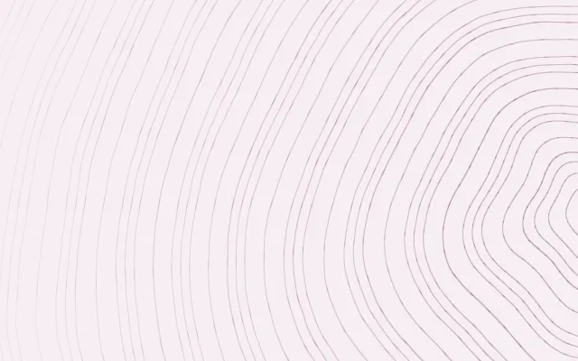 | 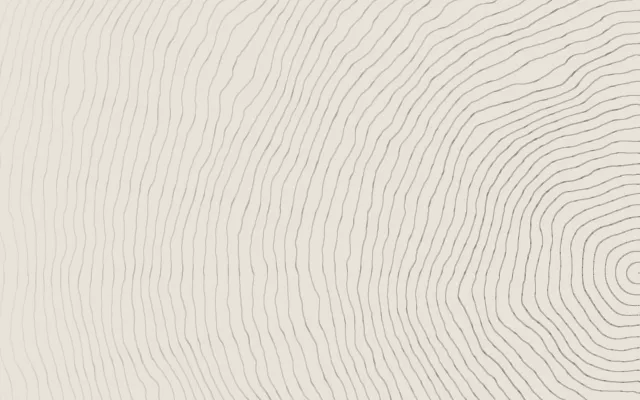 | 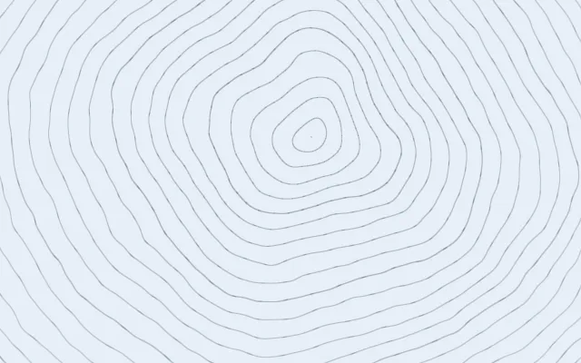 |

The same lines can also be shown as a 3D landscape. You can view it from any angle.

| | | |
|---|---|---|
| 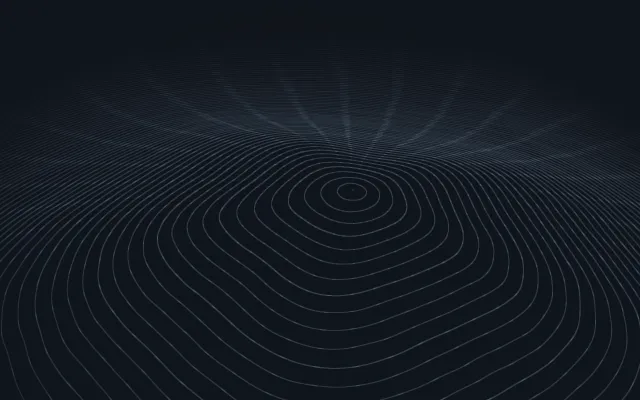 | 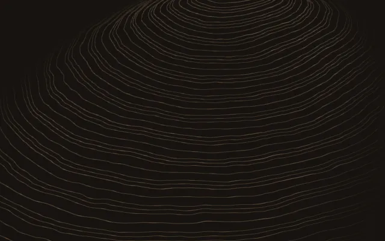 | 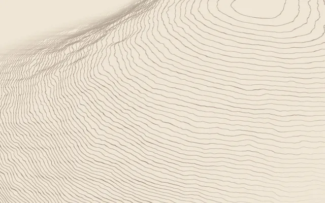 |

The landscape can also come from a real place, using real height data. The [playground](https://topographic.yahyapak.dev/) has ten places ready to use. You can also choose any area up to 300 km wide.

| | | | | |
|---|---|---|---|---|
| 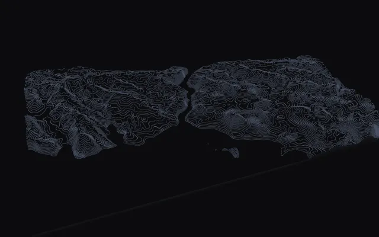<br>Istanbul | 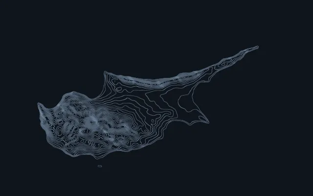<br>Cyprus | 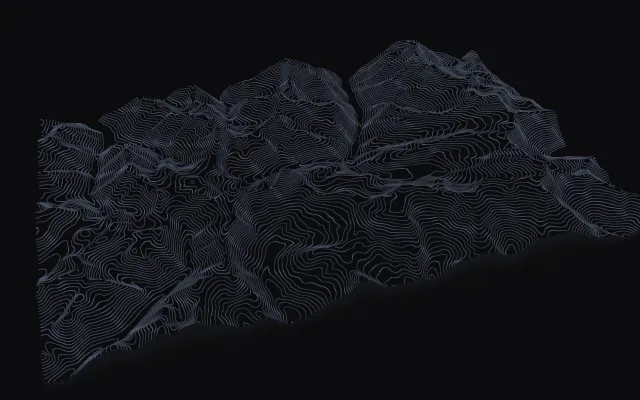<br>Matterhorn | 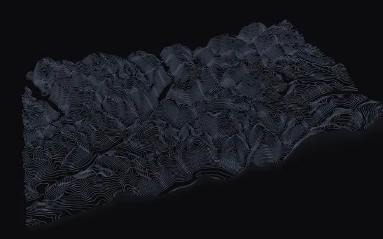<br>Geirangerfjord | 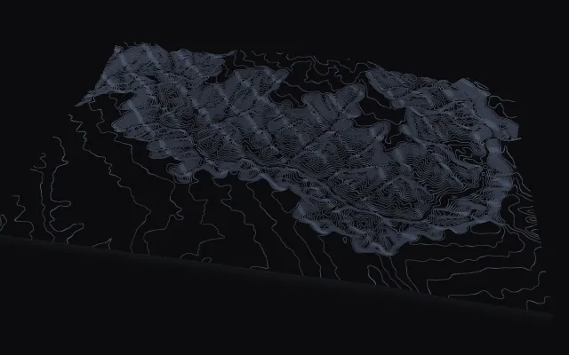<br>Grand Canyon |
| 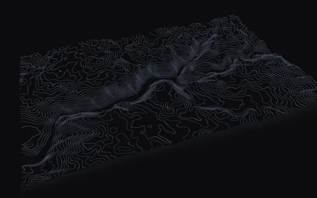<br>Yosemite | 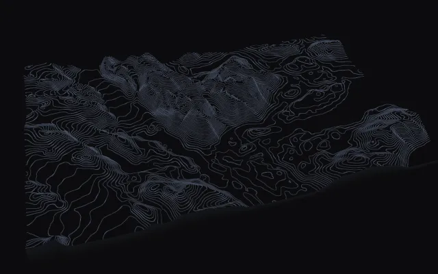<br>Torres del Paine | 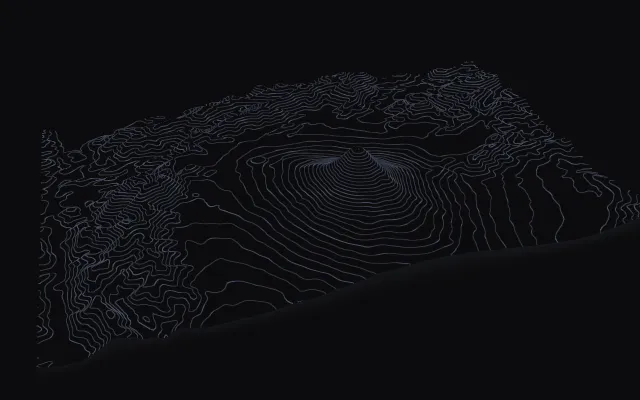<br>Mount Fuji | 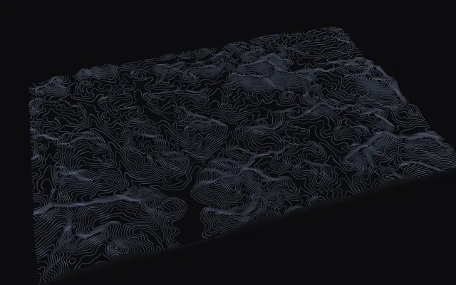<br>Everest | 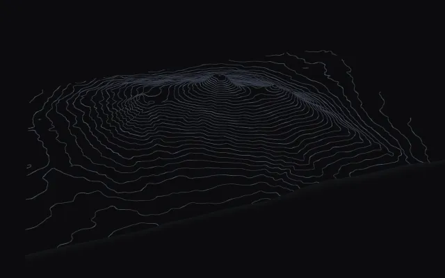<br>Kilimanjaro |

## Install

```sh
npm install topographic@0.3.0
```

In plain HTML, use the web component:

```html
<script type="module">import 'topographic/element';</script>

<topographic-bg style-name="long-ridge" style="position:fixed;inset:0;z-index:-1"></topographic-bg>
```

In JavaScript:

```js
import { createTopographicBackground } from 'topographic';

const topographic = createTopographicBackground(document.querySelector('#hero'), { style: 'long-ridge' });
```

In React, install `topographic-react` too (`npm install topographic@0.3.0 topographic-react@0.3.0`):

```tsx
import { TopographicBackground } from 'topographic-react';

<TopographicBackground styleName="long-ridge" style={{ height: '100vh' }} />
```

In the [playground](https://topographic.yahyapak.dev/), **Export** gives you this code with your settings filled in.

## Usage

### Settings

You control the background with one settings object. `style` picks the basic shape of the land. `seed` is a number that picks one version of that shape. `lines`, `terrain`, `motion`, `layout` and `theme` change the rest. You can change settings at any time with `topographic.update({ terrain: { peaks: 3 } })`.

The background stops drawing when it is not on screen. It does not move for people who turn on reduced motion. If the browser cannot run WebGL, it shows a plain colour.

### 3D

Add `mode: '3d'` to show the landscape in 3D. 2D is the default. The same settings give the same land in 2D and 3D.

```js
topographic.update({ mode: '3d', elevation: 0.7, extent: 'block', camera: { motion: 'orbit' } });
```

- `elevation` sets how tall the land is, from 0 (flat) to 1 (tall).
- `extent` is `endless` (the default) or `block`. With `endless`, the land fades out at the edges. With `block`, the land sits on a square base.
- `camera` sets where you look from: `azimuth` is the direction (349.7 by default), `elevation` is the height angle (33.6) and `radius` is the distance (1.92). `motion` makes the camera move: `still`, `orbit`, `push`, `flyover` or `drone`.
- `quality` is `auto`, `low`, `medium` or `high`. `auto` follows the device and steps down when frames miss 60 Hz, or 120 Hz on a faster screen. The other values stay put.
- In the [playground](https://topographic.yahyapak.dev/), drag in 3D to turn around the land. Scroll with two fingers to move it. Use ⌘/Ctrl + scroll or pinch to zoom. Double-click to centre it again. In 2D, drag moves the summit from the side toward the centre.

### Real places

In the [playground](https://topographic.yahyapak.dev/), open **Map**, choose an area up to 300 km wide, and click **Apply**. The playground downloads the height data for that area and shows it in 3D. A shared link to a place waits for those heights, and shows contour rings instead of the default terrain. In your own code, you can pass any grid of heights to `setHeightfield({ samples, size, aspect })`. Each height is a number from 0 (lowest) to 1 (highest).

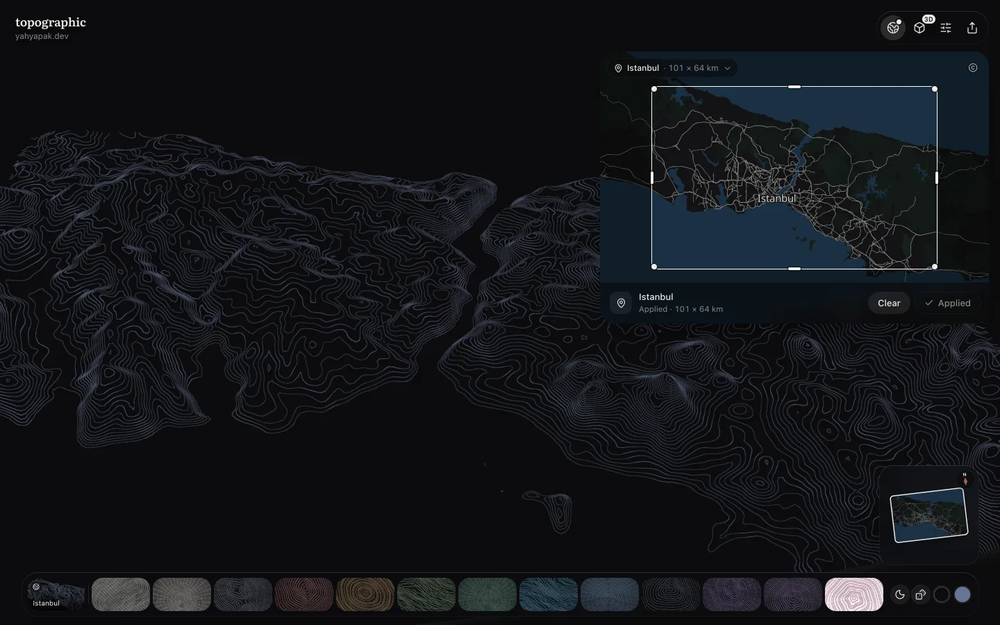

### Export

`snapshot()` saves a PNG image at any size. It can also save only part of the view, for example a phone-sized crop. `record()` saves a 3D video as MP4 or WebM. Both work in the background, so the page does not change while they run.

```js
const png = await topographic.snapshot({ width: 1920, height: 1080 });
const clip = await topographic.record({ seconds: 6, motion: 'orbit', format: 'mp4' });
```

### AI agents

The [playground](https://topographic.yahyapak.dev/) has plain-text docs for AI tools at [`llms.txt`](https://topographic.yahyapak.dev/llms.txt). In browsers that support [WebMCP](https://github.com/webmachinelearning/webmcp), an AI agent can use the playground directly. It can change the settings, choose a place, take a screenshot, record a video and get the code.

The [guide](docs/guide.md) lists every setting with its range and default. It also covers [3D](docs/guide.md#three-dimensions), [PNG export](docs/guide.md#snapshots-and-png-export), colours and themes, server rendering and the [WebMCP tools](docs/guide.md#webmcp-tools).

## How it works


The web component, the React component and the [playground](https://topographic.yahyapak.dev/) all use the same code. One renderer draws both 2D and 3D.

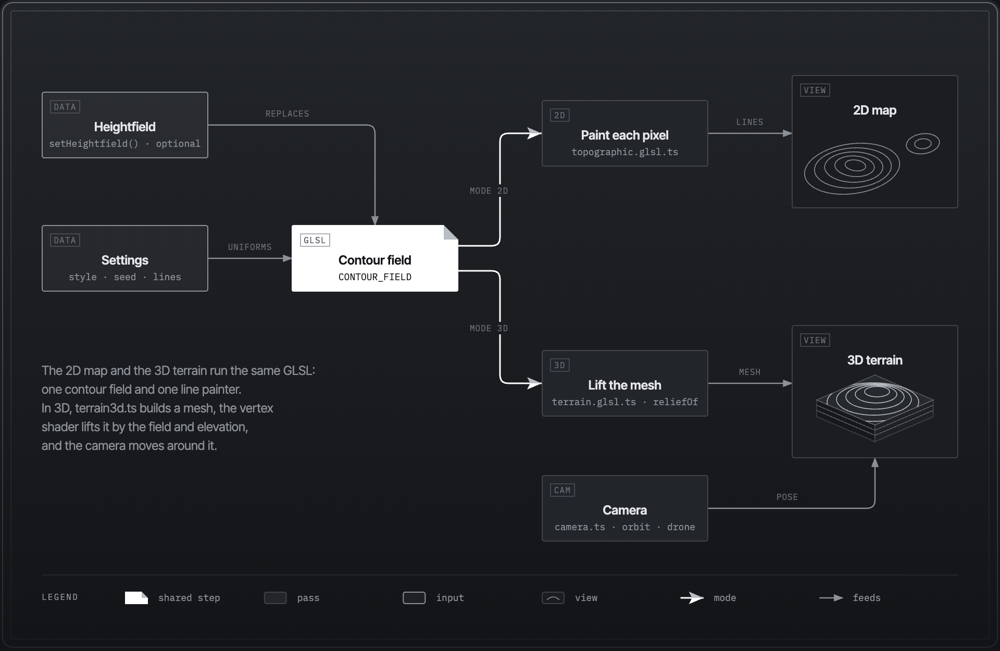

2D and 3D use the same land shape and the same lines. 3D only adds height and a camera.


The [playground](https://topographic.yahyapak.dev/) downloads height data for the area, smooths it and turns it into a grid of heights. `setHeightfield()` then draws it. The [low-level design](docs/low-level-design.md) explains each part.

## Contributing

Issues and pull requests are welcome. You need Node.js 20 or later.

```sh
npm install
npm run dev        # the playground, live
npm test           # unit tests
npm run build      # packages and the playground
npm run smoke      # headless Chrome checks (set CHROME=/path/to/chrome)
```

`scripts/readme-shots.mjs` retakes the images in this README.

## Credits

The code structure was inspired by [Paper Shaders](https://github.com/paper-design/shaders). Height data comes from Mapzen Terrain Tiles on AWS Open Data. Map images come from OpenFreeMap, OpenMapTiles and OpenStreetMap.

- [Playground](https://topographic.yahyapak.dev/)
- [`topographic`](https://www.npmjs.com/package/topographic) and [`topographic-react`](https://www.npmjs.com/package/topographic-react) on npm
- [Guide](docs/guide.md)

MIT licence. See [LICENSE](LICENSE).
