<p align="center"></p>

<h1 align="center">topographic</h1>

<p align="center">
  <a href="https://www.npmjs.com/package/topographic"></a>
  <a href="https://www.npmjs.com/package/topographic-react"></a>
  <a href="LICENSE"></a>
</p>

<p align="center">Topographic terrain rendered with WebGL. Generate a land or turn a real place into a topographic terrain.</p>

<p align="center"><a href="https://topographic.yahyapak.dev/"><b>Open the playground</b></a> · <a href="https://topographic.yahyapak.dev/docs">Docs</a> · <a href="https://www.npmjs.com/package/topographic">npm: topographic</a> · <a href="https://www.npmjs.com/package/topographic-react">npm: topographic-react</a></p>

<p align="center">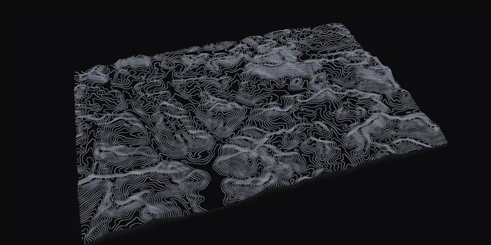</p>

With a coding agent, install the topographic skill and ask for a terrain:

```sh
npx skills add yahyabedirhan/topographic
```

By hand:

```sh
npm install topographic
```

```sh
npx skills add yahyabedirhan/topographic
```

The second line installs the topographic skill for your coding agent.

topographic draws terrain as contour lines, from real elevation data or from a shape and a seed.
The same settings draw the same land on every screen.

Each example below shows its code beside the terrain it draws.

## Real places

Name a place, and topographic draws it from real elevation data.

<table>
<tr>
<td width="44%">

```js
import { createTopography } from 'topographic';

createTopography(el, {
  location: 'everest',
});
```

</td>
<td>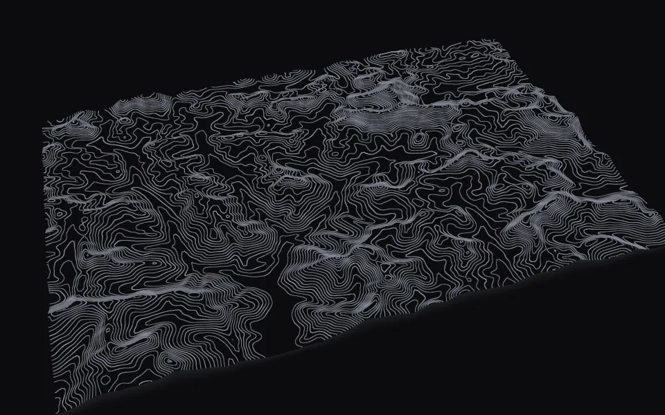</td>
</tr>
</table>

Ten places are built in.

<table>
<tr>
<td align="center" width="20%">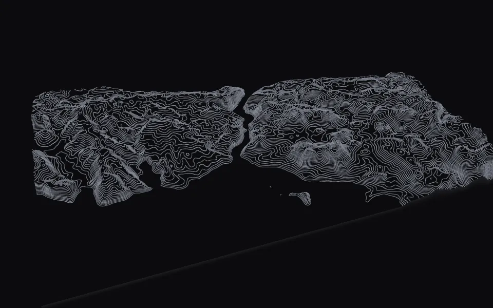<br><code>istanbul</code></td>
<td align="center" width="20%">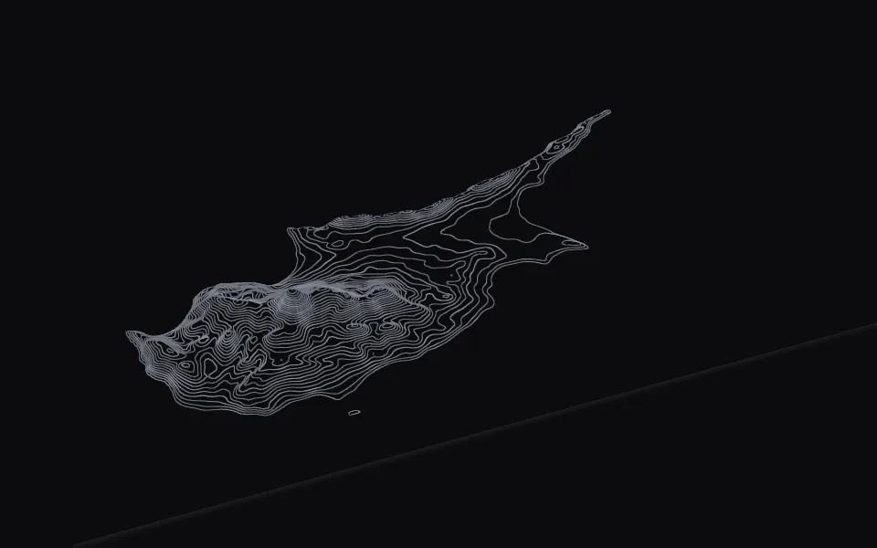<br><code>cyprus</code></td>
<td align="center" width="20%">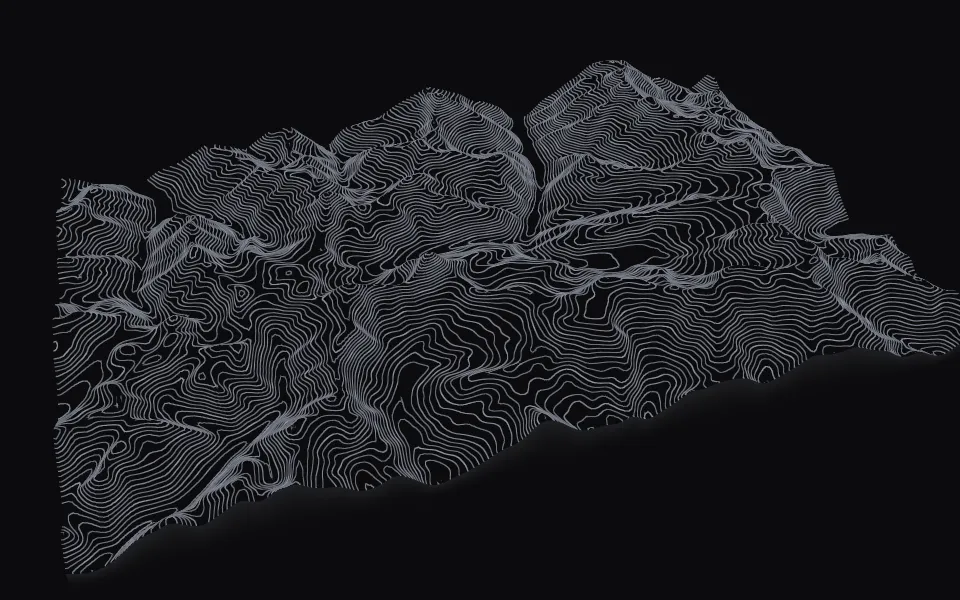<br><code>matterhorn</code></td>
<td align="center" width="20%">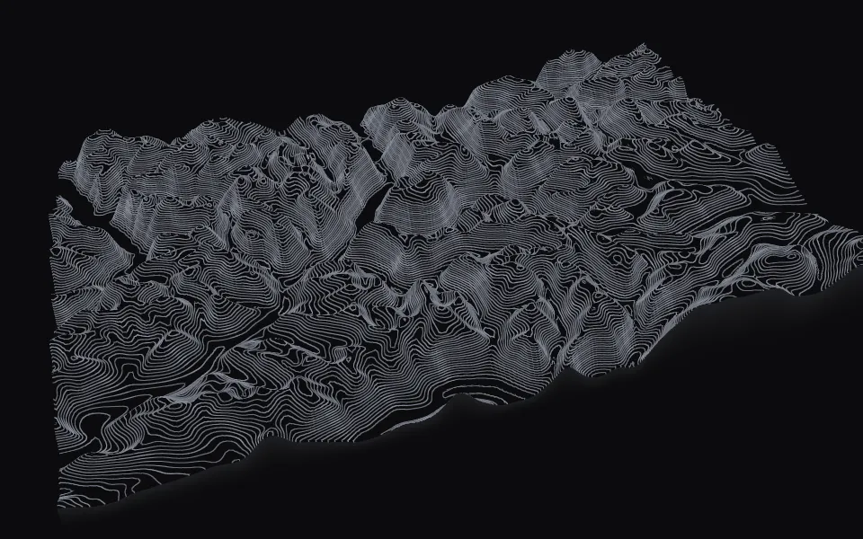<br><code>geirangerfjord</code></td>
<td align="center" width="20%"><br><code>grand-canyon</code></td>
</tr>
<tr>
<td align="center" width="20%">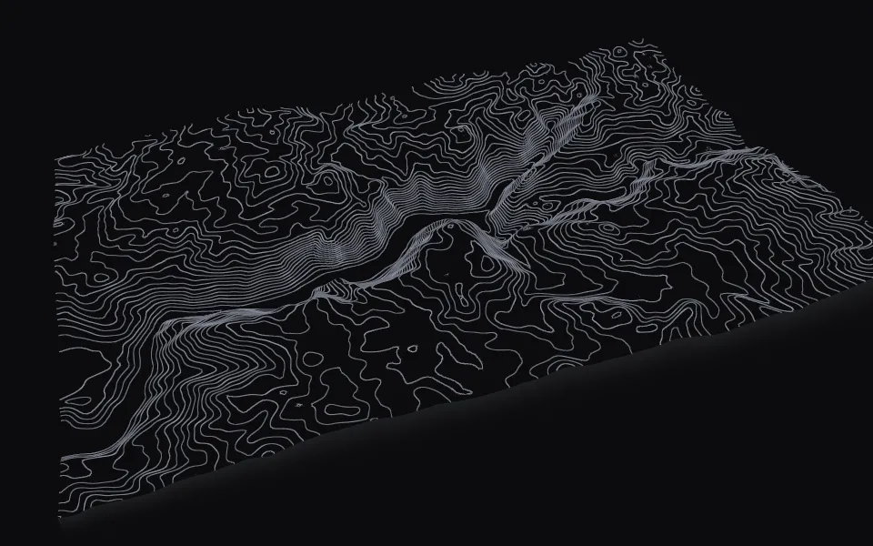<br><code>yosemite</code></td>
<td align="center" width="20%">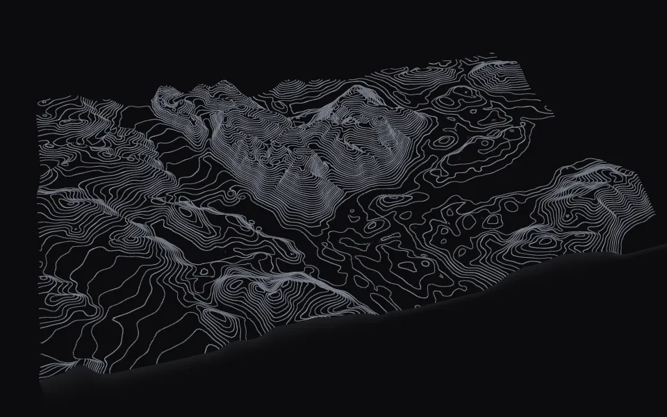<br><code>torres-del-paine</code></td>
<td align="center" width="20%">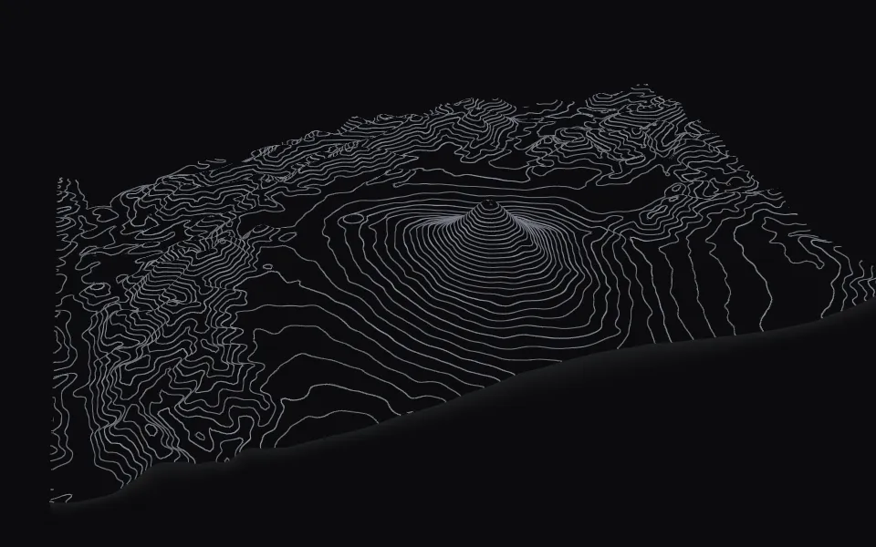<br><code>fuji</code></td>
<td align="center" width="20%"><br><code>everest</code></td>
<td align="center" width="20%">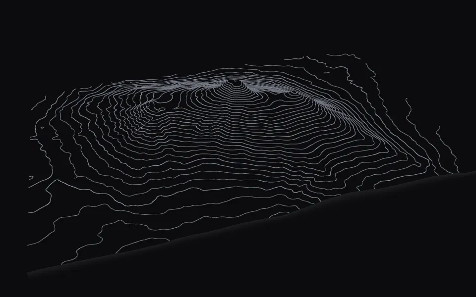<br><code>kilimanjaro</code></td>
</tr>
</table>

In the [playground](https://topographic.yahyapak.dev/), open **Map**, frame any other area and click **Apply**.
**Export** then gives you the code for it.

## Generated shapes

Without a place, topographic generates the land.
A shape sets its form, and every seed is a new land of that form.
Each step below adds to the one before.

<table>
<tr>
<td width="44%">

```js
createTopography(el, {
  shape: 'drifting-lobes',
  layout: { anchor: 1 },
});
```

</td>
<td>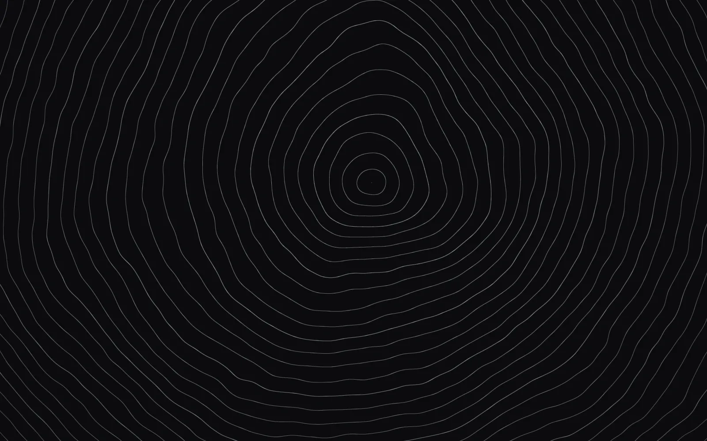</td>
</tr>
<tr>
<td>

```js
createTopography(el, {
  shape: 'granite',
  seed: 21,
  layout: { anchor: 1 },
});
```

</td>
<td>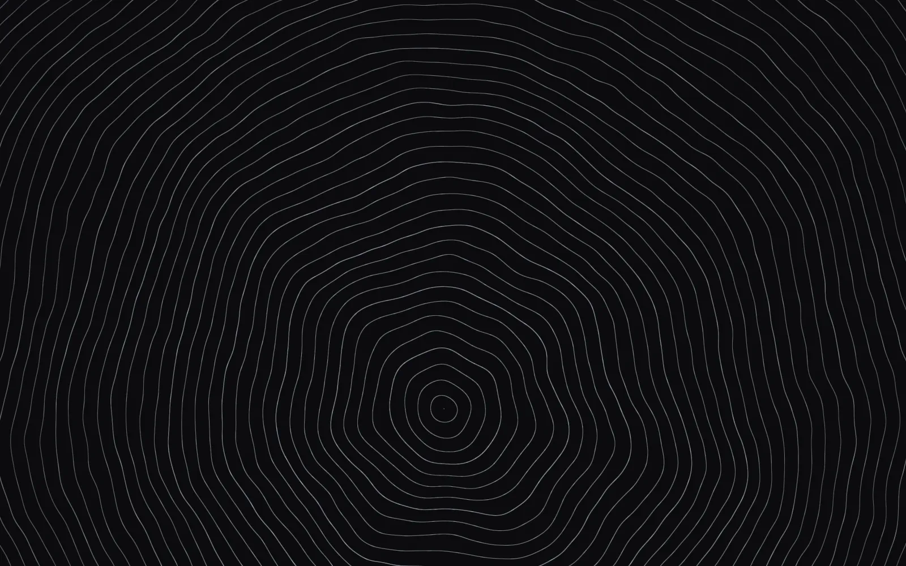</td>
</tr>
<tr>
<td>

```js
createTopography(el, {
  shape: 'granite',
  seed: 21,
  layout: { anchor: 1 },
  terrain: { peaks: 3, terracing: 0.85 },
});
```

</td>
<td>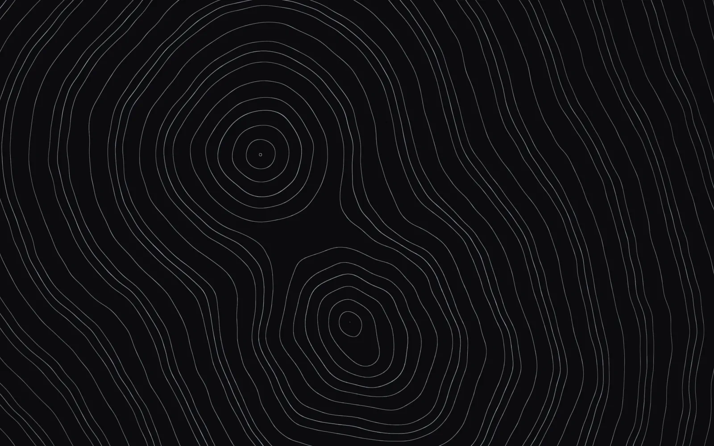</td>
</tr>
<tr>
<td>

```js
createTopography(el, {
  shape: 'granite',
  seed: 21,
  layout: { anchor: 1 },
  terrain: { peaks: 3, terracing: 0.85 },
  mode: '3d',
  elevation: 0.45,
  camera: { elevation: 42, radius: 2.6 },
  theme: { paper: '#120d07', ink: '#e0a24a' },
});
```

</td>
<td>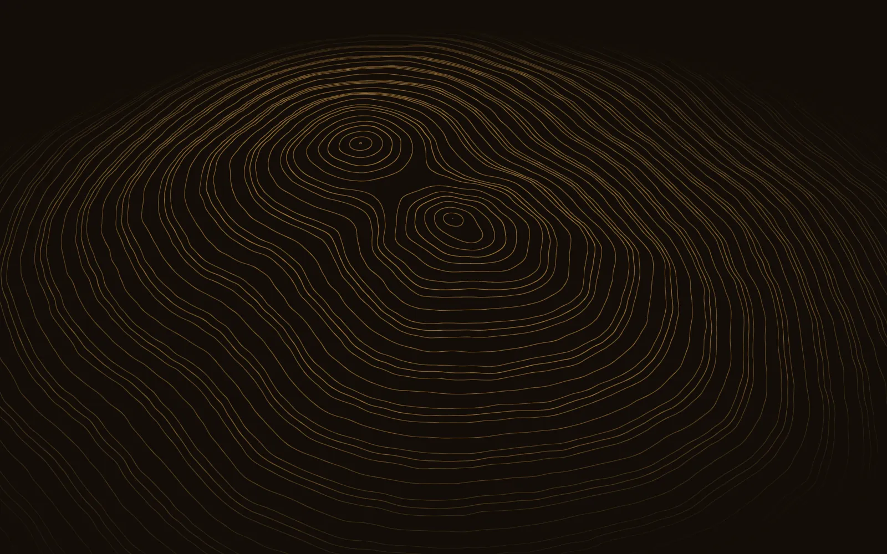</td>
</tr>
</table>

Every picture here also sets dark paper and a light ink, `theme: { paper: '#0b0b0d', ink: '#cfd8ea' }`, and brighter lines, which the code leaves out.

## 2D and 3D

The same land draws as a flat contour map or as a 3D terrain.
Here the Grand Canyon goes from 2D to 3D, then takes a new look and more lines.

<table>
<tr>
<td width="44%">

```js
createTopography(el, {
  location: 'grand-canyon',
  mode: '2d',
  lines: { count: 24 },
});
```

</td>
<td>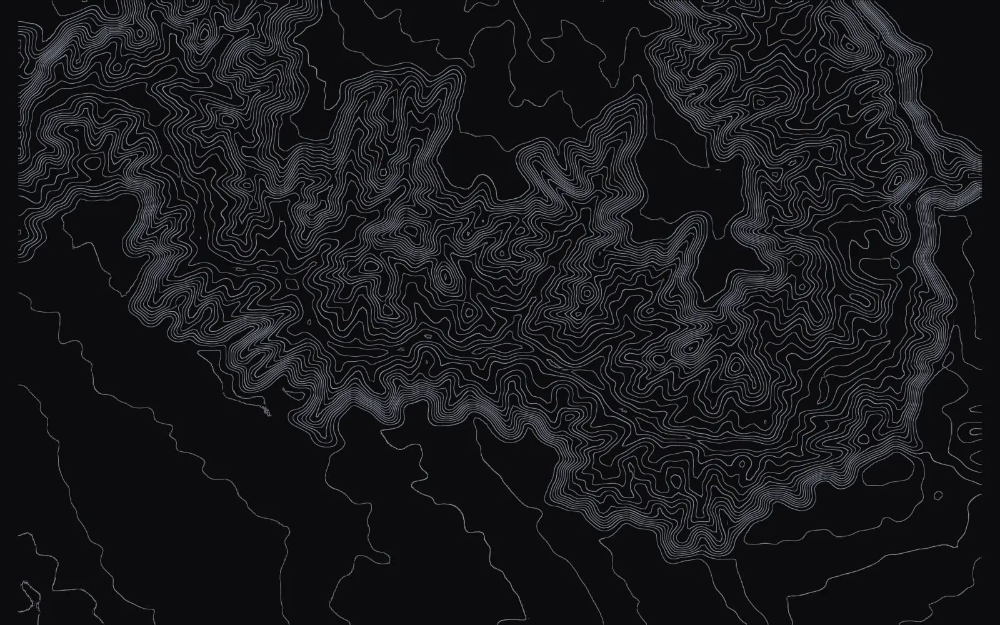</td>
</tr>
<tr>
<td>

```js
createTopography(el, {
  location: 'grand-canyon',
  mode: '3d',
  lines: { count: 24 },
});
```

</td>
<td>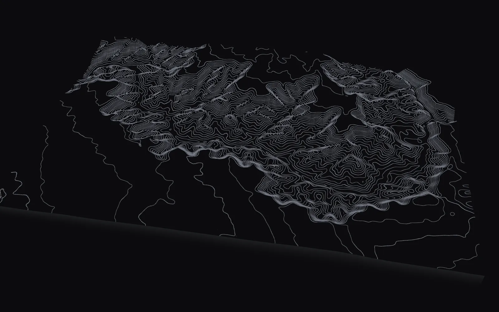</td>
</tr>
<tr>
<td>

```js
createTopography(el, {
  location: 'grand-canyon',
  mode: '3d',
  lines: { count: 24 },
  theme: { paper: '#efe6d2', ink: '#1f2a44' },
});
```

</td>
<td>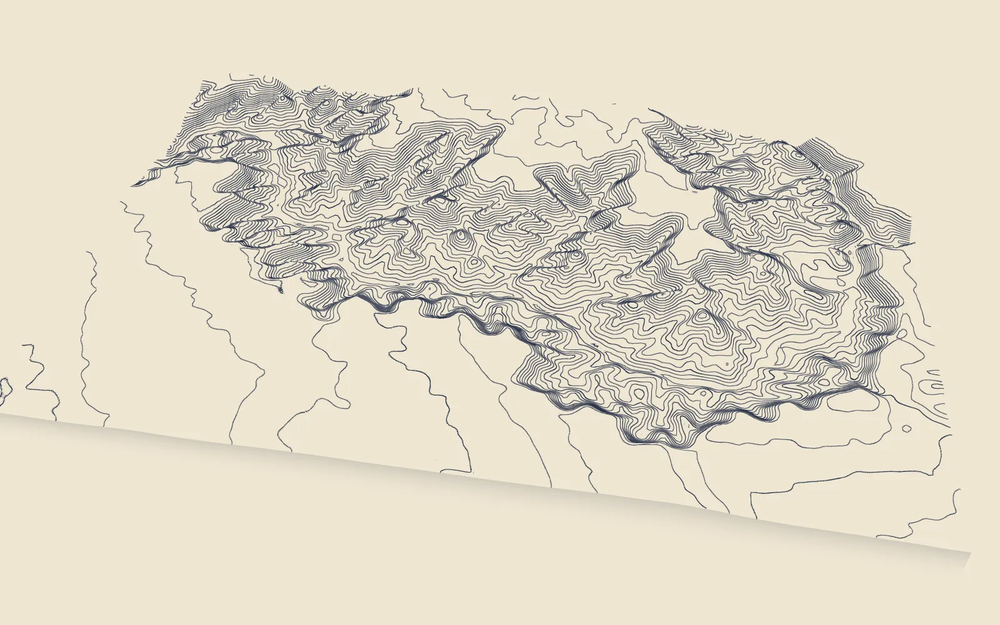</td>
</tr>
<tr>
<td>

```js
createTopography(el, {
  location: 'grand-canyon',
  mode: '3d',
  lines: { count: 60, indexEvery: 5 },
  theme: { paper: '#efe6d2', ink: '#1f2a44' },
});
```

</td>
<td>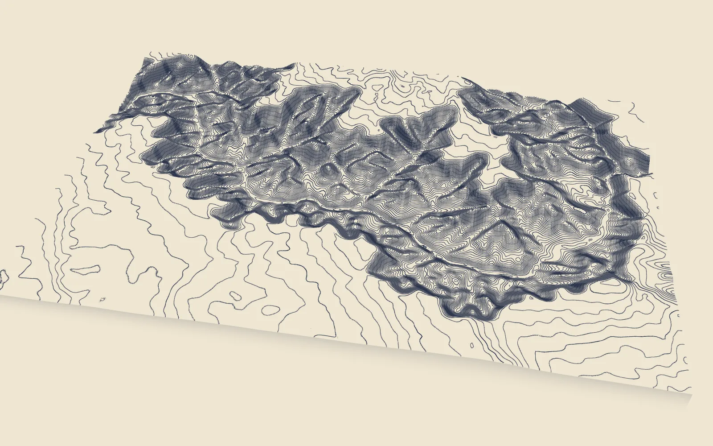</td>
</tr>
</table>

In 3D, `camera` sets the angle and the distance, and `camera.motion` moves it: `orbit`, `push`, `flyover` or `drone`.
The [guide](docs/guide.md#three-dimensions) lists every 3D setting.

## Usage

In plain HTML, use the web component:

```html
<script type="module">import 'topographic/element';</script>

<topographic-view location="fuji" mode="3d"></topographic-view>
```

In JavaScript, `createTopography` draws into an element and returns the instance:

```js
import { createTopography } from 'topographic';

const topography = createTopography(document.querySelector('#terrain'), { shape: 'long-ridge' });
topography.update({ terrain: { peaks: 3 } });
```

In React, install `topographic-react` too:

```sh
npm install topographic topographic-react
```

```tsx
import { Topography } from 'topographic-react';

<Topography location="yosemite" />
```

The terrain fills the element you give it.
The [guide](docs/guide.md#sizing-and-layering) shows how to size it and how to put content over it.
In the [playground](https://topographic.yahyapak.dev/), **Install** and **Export** give you this code with your settings filled in.

## Images and video

`snapshot()` draws a PNG at any size, or any part of the view.
`record()` draws a 3D video as MP4 or WebM.
Both draw off screen, so the page does not change while they run.

```js
const png = await topography.snapshot({ width: 1920, height: 1080 });
const clip = await topography.record({ seconds: 6, motion: 'orbit', format: 'mp4' });
```

## AI agents

The topographic skill teaches your coding agent the settings, the places and the code:

```sh
npx skills add yahyabedirhan/topographic
```

The [playground](https://topographic.yahyapak.dev/) has plain-text docs for AI tools at [`llms.txt`](https://topographic.yahyapak.dev/llms.txt).
In browsers that support [WebMCP](https://github.com/webmachinelearning/webmcp), an agent can use the playground directly: change the settings, choose a place, take a screenshot, record a video and get the code.

The [guide](docs/guide.md) lists every setting with its range and default, and covers colours and themes, server rendering and the [WebMCP tools](docs/guide.md#webmcp-tools).

## How it works


The web component, the React component and the [playground](https://topographic.yahyapak.dev/) all use the same code.
One renderer draws both 2D and 3D.


2D and 3D use the same land and the same lines.
3D adds height and a camera.


A real place starts as elevation tiles.
They are stitched, smoothed and turned into a grid of heights, which the renderer draws.
The [low-level design](docs/low-level-design.md) explains each part.

## Limits

- An area framed on the map in the playground can be up to 300 km wide.
- `record()` draws the 3D view only, up to 12 seconds a clip.
- topographic needs WebGL. Without it, the element shows a plain colour.
- It stops drawing when it is off screen, and draws one still frame for people who turn on reduced motion.

## Contributing

Issues and pull requests are welcome. You need Node.js 20 or later.

```sh
npm install
npm run dev        # the playground, live
npm test           # unit tests
npm run build      # packages and the playground
npm run smoke      # headless Chrome checks (set CHROME=/path/to/chrome)
```

`scripts/render-readme-assets.mjs` draws the images in this README, the npm pages and the social cards with the library itself.
`scripts/readme-shots.mjs` retakes the playground screenshots in `assets/screenshots/`.

## Credits

The code structure was inspired by [Paper Shaders](https://github.com/paper-design/shaders).
Height data comes from Mapzen Terrain Tiles on AWS Open Data.
Map images come from OpenFreeMap, OpenMapTiles and OpenStreetMap.

- [Playground](https://topographic.yahyapak.dev/)
- [Docs](https://topographic.yahyapak.dev/docs)
- [`topographic`](https://www.npmjs.com/package/topographic) and [`topographic-react`](https://www.npmjs.com/package/topographic-react) on npm
- [Guide](docs/guide.md)

## Privacy

The npm packages collect nothing.
The playground site sends cookieless analytics and error reports; [PRIVACY.md](PRIVACY.md) lists every event and how to opt out.

## License

The code is licensed under the [Apache License 2.0](LICENSE). See [LICENSE](LICENSE) and [NOTICE](NOTICE). If you use or adapt it, please credit Yahya Bedirhan Pak with a link to [yahyapak.dev](https://yahyapak.dev).

The project name, the logo in `assets/images/logo/`, the screenshots in `assets/screenshots/`, the images in `apps/playground/public/readme/` and `assets/social/`, and the social cards `apps/playground/public/og.png` and `og-docs.png` are not covered by this license and are all rights reserved.
