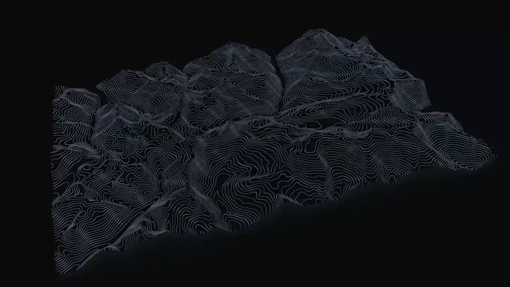

<p align="center"></p>

<h1 align="center">topographic</h1>

<p align="center">Animated contour-line backgrounds for the web, in 2D and 3D.<br>From generated terrain, or from any real place on Earth.</p>

<p align="center"><a href="https://yahyabedirhan.github.io/topographic/"><b>Open the playground</b></a> · <a href="#install">Install</a> · <a href="docs/guide.md">Guide</a></p>



topographic draws the lines of a topographic map behind your page. They drift slowly, follow light and dark mode, and lift into a 3D terrain when you want depth. It is a small npm library with no dependencies, plus a playground where you find a look and copy the code.


## Examples

**Looks.** Seven terrain styles, with lines, colours and motion you set. The same seed always gives the same map.

| | | |
|---|---|---|
|  |  |  |
|  |  |  |

**3D.** The same map, lifted into a terrain with a camera.

| | | |
|---|---|---|
|  |  |  |

**Real places.** Ten places are one click away in the playground, and the Map lets you frame any other.

| | | | | |
|---|---|---|---|---|
| <br>Istanbul | <br>Cyprus | <br>Matterhorn | <br>Geirangerfjord | <br>Grand Canyon |
| <br>Yosemite | <br>Torres del Paine | <br>Mount Fuji | <br>Everest | <br>Kilimanjaro |

## Install

```sh
npm install topographic@0.3.0
```

**HTML.** A web component:

```html
<script type="module">import 'topographic/element';</script>

<topographic-bg style-name="long-ridge" style="position:fixed;inset:0;z-index:-1"></topographic-bg>
```

**JavaScript:**

```js
import { createTopographicBackground } from 'topographic';

const topographic = createTopographicBackground(document.querySelector('#hero'), { style: 'long-ridge' });
```

**React** (`npm install topographic@0.3.0 topographic-react@0.3.0`):

```tsx
import { TopographicBackground } from 'topographic-react';

<TopographicBackground styleName="long-ridge" style={{ height: '100vh' }} />
```

The fastest way to settings you like: tune them in the [playground](https://yahyabedirhan.github.io/topographic/) and copy the code from **Export**.

## 2D and 3D

**Settings.** Every look comes from one set of readable settings: a `style` and `seed`, then `lines`, `terrain`, `motion`, `layout` and `theme`. Change them live with `topographic.update({ terrain: { peaks: 3 } })`. The background pauses when nobody can see it, holds still for people who prefer less motion, and shows a plain colour where WebGL isn't available.

**3D.** Add `mode: '3d'`. 2D stays the default, and the same seed gives the same map in both.

```js
topographic.update({ mode: '3d', elevation: 0.7, extent: 'block', camera: { motion: 'orbit' } });
```

- `elevation` sets how tall the terrain is, from flat (0) to tall (1).
- `extent` is `endless` (the default), terrain that runs past the view, or `block`, a tabletop with layer lines on its sides.
- `camera` places the view (`azimuth` 349.7, `elevation` 33.6, `radius` 1.92 by default), and `motion` moves it: `still`, `orbit`, `push`, `flyover` or `drone`.
- In the playground, drag to orbit, scroll with two fingers to pan, ⌘/Ctrl + scroll or pinch to zoom, and double-click to recentre.

**Real places.** In the playground, open **Map**, frame an area up to 300 km on a side, and click **Apply**. A worker turns elevation tiles into a grid, and the view switches to 3D. The library takes any such grid through `setHeightfield({ samples, size, aspect })`, with values from 0 to 1.


**Export.** `snapshot()` renders a PNG at any size, or only a slice of the view, such as a phone-shaped crop. `record()` renders a 3D clip as MP4 or WebM. Both draw off-screen, so the live background keeps its size.

```js
const png = await topographic.snapshot({ width: 1920, height: 1080 });
const clip = await topographic.record({ seconds: 6, motion: 'orbit', format: 'mp4' });
```

**AI agents.** The playground serves plain-text docs at [`llms.txt`](https://yahyabedirhan.github.io/topographic/llms.txt). In browsers with [WebMCP](https://github.com/webmachinelearning/webmcp), an agent can change the settings, pick a place, take a screenshot, record a clip and get the embed code.

The [guide](docs/guide.md) has the full reference: every setting with its range and default, [3D](docs/guide.md#three-dimensions), [PNG export](docs/guide.md#snapshots-and-png-export), theming, server rendering and the [WebMCP tools](docs/guide.md#webmcp-tools).

## How it works


Every wrapper calls one API, and one renderer draws 2D or 3D from the same resolved settings.


The 2D map and the 3D terrain run the same contour field and line painter.


A worker turns the framed area into a smoothed 0..1 grid, and `setHeightfield()` draws it. The [low-level design](docs/low-level-design.md) explains the pieces and why.

## Contributing

Issues and pull requests are welcome. You need Node.js 20 or later.

```sh
npm install
npm run dev        # the playground, live
npm test           # unit tests
npm run build      # packages and the playground
npm run smoke      # headless Chrome checks (set CHROME=/path/to/chrome)
```

`scripts/readme-shots.mjs` retakes the images in this README.

## Credits

The shader is ported from the maintainer's personal website prototype. The architecture was inspired by [Paper Shaders](https://github.com/paper-design/shaders). Elevation comes from Mapzen Terrain Tiles on AWS Open Data, and the map from OpenFreeMap, OpenMapTiles and OpenStreetMap.

- [Playground](https://yahyabedirhan.github.io/topographic/)
- [`topographic`](https://www.npmjs.com/package/topographic) and [`topographic-react`](https://www.npmjs.com/package/topographic-react) on npm
- [Guide](docs/guide.md)

MIT licence. See [LICENSE](LICENSE).
