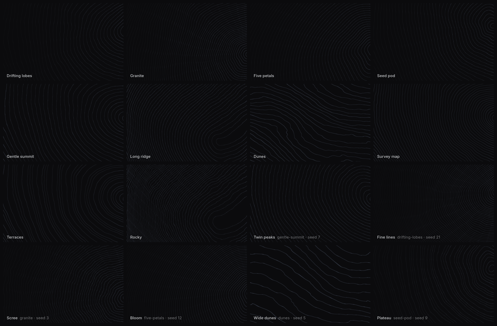

# topographic guide

This guide explains how to use topographic. Each section covers one topic. To try the settings live, open the [playground](https://topographic.yahyapak.dev/). To see how the parts of the code fit together, read [design.md](low-level-design.md).

- [Install](#install)
- [Three ways to use it](#three-ways-to-use-it)
- [Settings](#settings)
- [Styles](#styles)
- [Presets](#presets)
- [Colours, CSS variables and dark mode](#colours-css-variables-and-dark-mode)
- [Seed](#seed)
- [Snapshots and PNG export](#snapshots-and-png-export)
- [Performance and accessibility](#performance-and-accessibility)
- [Fallbacks](#fallbacks)
- [Server rendering and Next.js](#server-rendering-and-nextjs)
- [The playground](#the-playground)
- [WebMCP tools](#webmcp-tools)
- [Troubleshooting](#troubleshooting)

## Install

```sh
npm install topographic            # core and the web component
npm install topographic-react      # React bindings (needs React 18 or 19)
```

The packages are ESM only. They have no dependencies. They are marked as side-effect free, except `topographic/element`. That one registers the element when you import it.

On npm: [`topographic`](https://www.npmjs.com/package/topographic) and [`topographic-react`](https://www.npmjs.com/package/topographic-react).

## Three ways to use it

### Vanilla JavaScript: `createTopographicBackground`

```js
import { createTopographicBackground } from 'topographic';

const topographic = createTopographicBackground(element, settings?, options?);
```

The call adds a canvas inside `element`. The canvas fills the element, so give the element a size. The call returns an instance with these members:

| Member | What it does |
|---|---|
| `update(partialSettings)` | Changes some settings and applies them right away. Values are kept inside their ranges. Only the changed values are sent to the GPU. |
| `snapshot({ frame?, width?, height?, region?, motion? })` | Draws one PNG image in the background and returns it as a `Blob`. See [Snapshots](#snapshots-and-png-export). |
| `record({ seconds?, fps?, width?, height?, frame?, format?, motion? })` | Records a short 3D video with a moving camera. Returns it as an MP4 or WebM `Blob`. |
| `setHeightfield({ samples, size, aspect } \| null)` | Draws the lines from your own elevation data (a height map) instead of the style's shape. The data is a square grid. `samples` is a `Float32Array` of `size × size` values, from 0 (low) to 1 (high). Row 0 is the south edge. `aspect` is the place's width divided by its height. `null` brings back the style's own shape. |
| `setInsets({ top, right, bottom, left } \| null)` | Tells the 3D view how much space your page's UI covers on each side, in CSS pixels. A toolbar or a dock are examples. The 3D picture then moves so the terrain is centred in the free space. The camera does not move, so orbiting still turns around the terrain. 2D does not change. Snapshots and videos ignore this setting (see [Snapshots](#snapshots-and-png-export)). `null` clears it. `insets` reads it back. |
| `clampPan(panX, panZ)` | Returns the pan as `[x, z]`, limited so the view stays over the terrain. This is the same limit the renderer uses for `camera.panX` and `camera.panZ`. |
| `stats` | `{ fps, frameMs, mesh, quality }` for the 3D view. `mesh` is 0 in 2D. `quality` is the tier actually drawing: `low`, `medium` or `high`. |
| `pose` | `{ azimuth, elevation, radius, panX, panZ }`: where the 3D camera is now on its motion path. At azimuth 0, the camera looks from the south and north is at the top of the screen. The angle grows clockwise, as seen from above. So as it grows, north turns towards the right of the screen. |
| `destroy()` | Stops drawing. Removes the listeners and the canvas, and frees the WebGL context. |
| `settings` | The current settings, with every value filled in. |
| `status` | `'webgl2'`, `'webgl1'`, `'fallback'`, `'lost'` or `'destroyed'`. |
| `canvas` | The canvas element. |

`options` is optional. You rarely need it:

| Option | Default | What it does |
|---|---|---|
| `maxPixelRatio` | `2` | The highest device pixel ratio to draw at. A `quality` setting can cap it further. |
| `maxPixels` | `4147200` (1920×1080×2) | The most pixels to draw. Above this, the canvas draws at a lower resolution. A `quality` setting can cap this further. |
| `forceWebGL1` | `false` | Skip WebGL2. Useful for testing. |

### Web component: `<topographic-bg>`

```html
<script type="module">import 'topographic/element';</script>

<topographic-bg style-name="long-ridge" line-count="36" peaks="2" theme="dark"></topographic-bg>
```

- Every setting has an HTML attribute (listed in [Settings](#settings)). There are also `style-name`, `seed`, `theme`, `ink` and `paper`.
- A changed attribute applies right away. A removed attribute goes back to the style's default.
- `element.topographic` is the instance. `element.snapshot(opts)` is a shortcut to its `snapshot`.
- The element is `display: block`. Size and position it with CSS, for example `position: fixed; inset: 0; z-index: -1`.

### React: `<TopographicBackground>` and `useTopographicBackground`

```tsx
import { TopographicBackground, useTopographicBackground } from 'topographic-react';

<TopographicBackground
  styleName="dunes"
  lines={{ count: 24 }}
  theme={{ mode: 'dark' }}
  style={{ position: 'fixed', inset: 0, zIndex: -1 }}
/>
```

- Props: `styleName`, `seed`, `lines`, `terrain`, `motion`, `layout`, `theme`, `mode`, `elevation`, `extent`, `detail`, `quality`, `camera`, `options`, `onReady`, plus any `div` props. Children are drawn on top.
- The prop is `styleName`, not `style`. `style` stays React's normal inline style.
- Each group of settings updates only when its values change. A new object with the same values does nothing.
- `onReady(instance)` gives you the instance after mount, for example to call `snapshot`. It gives `null` on unmount.
- A change to `options` creates the renderer again. Every other change updates in place.

To use your own element, use the hook:

```tsx
const ref = useTopographicBackground({ styleName: 'seed-pod' });
return <section ref={ref} style={{ height: 400 }} />;
// ref.topographic is the instance while mounted
```

## Settings

The settings are in groups. Pass only the values you want to change:

```js
{
  style: 'dunes',
  seed: 0,
  lines:   { count, width, opacity, indexEvery },
  terrain: { peaks, spread, roughness, sharpness, terracing, variant },
  motion:  { speed, warp, sparkle },
  layout:  { anchor, fade },
  theme:   { mode, ink, paper },
  quality: 'auto',
}
```

A value outside its range is moved to the nearest limit. Whole-number settings are rounded. A value that is not a number uses the default. Some styles have their own defaults. For example, dunes uses a lighter centre fade.

### Lines

| Setting | Attribute | Range | Default | What it does |
|---|---|---|---|---|
| `lines.count` | `line-count` | 6–60, whole | 30 | How many contour lines there are. |
| `lines.width` | `line-width` | 0–1 | 0.26 | How thick each line is. |
| `lines.opacity` | `line-opacity` | 0–1 | 0.4 | How strongly the lines show against the background. |
| `lines.indexEvery` | `index-every` | 0–10, whole | 5 | Draws every Nth line bolder, like the index lines on a map. 0 turns it off. The playground calls it **Bold lines** ("1 in 5"). |

### Terrain

| Setting | Attribute | Range | Default | What it does |
|---|---|---|---|---|
| `terrain.peaks` | `peaks` | 1–6, whole | 1 | How many summits the terrain has. |
| `terrain.spread` | `spread` | 0–1 | 0.5 | How far the extra peaks are from the main summit. |
| `terrain.roughness` | `roughness` | 0–1 | 0 | Adds noise to the slopes. Low is smooth hills. High is rocky ground. |
| `terrain.sharpness` | `sharpness` | 0–1 | 0.5 | Below 0.5, summits get flatter. Above 0.5, they get sharper. |
| `terrain.terracing` | `terracing` | 0–1 | 0 | Groups the lines into steps. |
| `terrain.variant` | `variant` | 0–1 | 0.5 | Changes the shape in a way that depends on the style. For drifting lobes, it goes from three lobes to four. |

### Motion

| Setting | Attribute | Range | Default | What it does |
|---|---|---|---|---|
| `motion.speed` | `speed` | 0–3 | 1 | Animation speed. 0 stops the animation. |
| `motion.warp` | `warp` | 0–1 | 0.47 | How much the lines wobble as they move. |
| `motion.sparkle` | `sparkle` | 0–1 | 0.6 | Small bright dots that travel along the lines. |

### Layout

| Setting | Attribute | Range | Default | What it does |
|---|---|---|---|---|
| `layout.anchor` | `anchor` | 0–1 | 0 | 0 keeps the summit to the side. 1 puts it in the centre. |
| `layout.fade` | `fade` | 0–1 | 0.7 | Fades the lines behind a text column in the centre. |

### Three dimensions

`mode` is `'2d'` or `'3d'`. 2D is the default. 3D shows the same contour lines as a landscape. With the same seed and settings, you get the same map in both modes. You can switch between them at any time.

| Setting | Attribute | Range | Default | What it does |
|---|---|---|---|---|
| `mode` | `mode` | `2d`, `3d` | `2d` | The flat map, or the same map as a landscape. |
| `elevation` | `elevation` | 0–1 | 0.62 | How tall the 3D terrain is. 0 is flat, like the map. Higher values make it taller, with a rounded top. |
| `extent` | `extent` | `endless`, `block` | `endless` | `endless` is a plane that fades into the background colour. `block` is a solid slab. Its sides fade softly into the background colour. |
| `detail` | `detail` | 0–1 | 0.5 | How many points the 3D surface has, from a 32² grid to a 160² grid. |
| `quality` | `quality` | `auto`, `low`, `medium`, `high` | `auto` | Graphics budget. `auto` follows the device and steps down if frames miss 60 Hz, or 120 Hz once that refresh has been seen. `low`, `medium` and `high` stay put. The budget caps the pixel ratio, the pixel count and the mesh size. |
| `camera.azimuth` | `azimuth` | any finite number | 349.7 | The camera's angle around the terrain, in degrees. |
| `camera.elevation` | `camera-elevation` | 2–80 | 33.6 | The camera's angle above the horizon, in degrees. The camera never goes below the terrain. |
| `camera.radius` | `radius` | 1.15–6.5 | 1.92 | The camera's distance from the centre of the terrain. |
| `camera.motion` | `camera-motion` | `still`, `orbit`, `push`, `flyover`, `drone` | `still` | Makes the camera move. `motion.speed` still animates the terrain shape. |
| `camera.panX`, `camera.panZ` | `pan-x`, `pan-z` | −6–6 | 0 | The point the camera looks at, moved from the centre of the terrain. X is east and Z is south, in terrain units. The camera and every motion path turn around this point. The point stays over the terrain, so part of the terrain is always in view. |

```js
createTopographicBackground(el, {
  style: 'gentle-summit',
  seed: 4,
  mode: '3d',
  elevation: 0.7,
  extent: 'block',
  camera: { azimuth: 42, elevation: 34, radius: 2.45, motion: 'orbit' },
});
```

The default camera looks from a little west of south. It is about a third of the way up. It is close enough that the terrain fills a wide window. `record({ motion: 'flyover', format: 'mp4' })` records a video. It does not resize the live canvas. You can also use `format: 'webm'` if the browser can encode it.

## Styles

There are seven base styles. Each one is a different starting shape. The settings change each style in many ways, so the number of possible looks is not limited to seven.

| Id | Name | Looks like |
|---|---|---|
| `drifting-lobes` | Drifting lobes | Three soft lobes that drift to the side and slowly change towards four. |
| `granite` | Granite | Many small, lumpy lobes with a stone-like texture. |
| `five-petals` | Five petals | A summit with five petals that slowly grows and shrinks. |
| `seed-pod` | Seed pod | Two long lobes that turn slowly, like a seed pod. |
| `gentle-summit` | Gentle summit | One soft, slightly oval hill that leans as it moves. |
| `long-ridge` | Long ridge | A long, winding ridge with rounded ends. |
| `dunes` | Dunes | Long ripples, like sand shaped by wind. There are no summits. |

An unknown style uses `drifting-lobes` instead and prints one warning in the console.

`terrain.variant` changes the shape in a way that depends on the style. Today it has the biggest effect on drifting lobes, where it goes from three lobes to four.

### The styles image



The image shows every style and preset in dark mode. Each tile is the frame at 4 seconds. The first ten tiles are the styles and presets, by name. The last six tiles each use a style with a different seed and one or two changed settings:

| Tile | Settings |
| --- | --- |
| Twin peaks | `drifting-lobes`, seed 7, peaks 2, spread 1 |
| Fine lines | `drifting-lobes`, seed 21, line count 48 |
| Scree | `granite`, seed 3, roughness 0.6 |
| Bloom | `five-petals`, seed 12, line count 42, variant 0.9 |
| Wide dunes | `dunes`, seed 5, line count 16, line width 0.4 |
| Plateau | `seed-pod`, seed 9, terracing 0.6 |

The tiles are small, so every tile uses a few extra settings to make the shapes easy to see. The summit is in the centre (`layout.anchor` 1). The centre fade is off (`layout.fade` 0). The lines are brighter and a little thicker: line opacity 0.85, line width 0.4 and ink `#9fb0cc`. To make the image again, run `node scripts/styles-grid.mjs`.

## Presets

A preset is a named starting point. It is a style plus a few settings. The presets are exported as `PRESETS`.

- **Drifting lobes**: `{"style":"drifting-lobes"}`
- **Granite**: `{"style":"granite","lines":{"count":34},"terrain":{"roughness":0.15}}`
- **Five petals**: `{"style":"five-petals"}`
- **Seed pod**: `{"style":"seed-pod","motion":{"speed":0.7}}`
- **Gentle summit**: `{"style":"gentle-summit","lines":{"count":26}}`
- **Long ridge**: `{"style":"long-ridge","terrain":{"sharpness":0.4}}`
- **Dunes**: `{"style":"dunes","motion":{"sparkle":0.3}}`
- **Survey map**: `{"style":"gentle-summit","lines":{"count":44,"indexEvery":5,"opacity":0.55},"terrain":{"peaks":3,"spread":0.6,"roughness":0.2},"motion":{"speed":0.4,"sparkle":0}}`
- **Terraces**: `{"style":"gentle-summit","terrain":{"terracing":0.8,"peaks":2},"motion":{"sparkle":0.2}}`
- **Rocky**: `{"style":"long-ridge","terrain":{"roughness":0.55,"sharpness":0.3},"lines":{"count":36}}`

```js
import { PRESETS, createTopographicBackground } from 'topographic';
createTopographicBackground(el, PRESETS.find((p) => p.name === 'Survey map').settings);
```

## Colours, CSS variables and dark mode

There are two colours. `ink` is the line colour. `paper` is the background colour. Each colour comes from the first of these that is set: the settings, then the CSS variables, then the light or dark defaults.

```css
topographic-bg, .my-hero {
  --topographic-ink: #9fb3c8;
  --topographic-paper: transparent;
}
```

- `theme.mode`: `auto` is the default. It follows the operating system and changes when the system changes. `light` or `dark` always use that mode.
- `theme.ink` / `theme.paper`: any CSS colour, including named colours and `oklch()`.
- **Transparent paper:** with `paper: 'transparent'`, your page shows through the background.
- **Light mode** draws ink lines on the paper. In **dark mode**, the lines glow softly on dark paper.
- If you change a CSS variable later, call `update({ theme: {} })` to read it again.

## Seed

The seed is a number that picks a variation of a style. `seed` is a whole number from 0 to 999999. The same seed gives the same terrain on every screen. `0` is the original look. Change the seed to get a new variation of a style. The other settings stay the same.

## Snapshots and PNG export

```js
const blob = await topographic.snapshot({ width: 1920, height: 1080, frame: 4000 });
```

- It draws in the background. The live canvas keeps its size and keeps animating.
- `patch` and `field` draw that image from temporary settings and a temporary height grid. The live view is put back before the call returns, so the page does not flash and a second WebGL context is not required.
- To keep the on-screen shape, give only `width` or only `height`. If you give neither, you get the current drawing size.
- `frame` is the animation time in milliseconds. The same settings and the same frame always give the same image.
- `region` keeps only part of the view: `{ x, y, width, height }`, as fractions measured from the top-left corner. The image is exactly that part of the screen, at `width` × `height` pixels. For example, you can take a phone-shaped strip from a wide window.
- `motion` draws the 3D view at a point on a camera path (`'orbit'`, `'push'` and so on). The point is the camera's position at `frame`. You get the same picture as that moment of `record`.
- It always centres the terrain in the image and ignores `setInsets`, because an image has no toolbar. A `region` is a part of that centred image. `record` works the same way.
- The largest size is the GPU's maximum renderbuffer size, usually 8192 or 16384 pixels. With a `region`, the limit applies to the whole view, not only the region.
- Without WebGL, it fails (the promise rejects).

The playground's PNG export uses this. The sizes are 2× the window, a phone size, or 1920 × 1080.

## Performance and accessibility

- **Paused when hidden:** drawing stops when the element is off-screen or the tab is hidden. It starts again when it is visible.
- **Still when nothing moves:** when `motion.speed` is 0, there is no animation loop. It draws again only when something changes.
- **Reduced motion:** when the system asks for reduced motion, it draws one still frame and ignores speed.
- **Pixel limit:** the pixel ratio is at most 2, and `quality` can cap it lower. Very large canvases draw at a lower resolution above `maxPixels`. The GPU code smooths the lines, so they stay sharp.
- **Graphics budget:** `quality: 'auto'` starts a phone at low and a desktop at high, then steps down when frames miss the refresh period. It does not step back up. Set `low`, `medium` or `high` to keep one tier.
- **Screen readers:** the canvas is `aria-hidden`, because it is only decoration. Put real content on top of it.
- **Readability:** `layout.fade` makes the lines softer behind a text column in the centre. `layout.anchor` moves the main summit from the side (0) to the centre (1).

## Fallbacks

| Situation | What you see |
|---|---|
| WebGL2 available | Full rendering (`status: 'webgl2'`) |
| Only WebGL1 | The same rendering through WebGL1 (`'webgl1'`) |
| No WebGL at all | Only the paper colour, and one console warning (`'fallback'`) |
| The GPU context is lost | Only the paper colour until the browser restores the context. If the browser never restores it, the canvas is replaced and drawing starts again (`'lost'` until then) |

## Server rendering and Next.js

Nothing uses the DOM or WebGL until the code runs in the browser.

- **React:** `topographic-react` starts with `'use client'`. On the server, `<TopographicBackground>` renders an empty `div`. The canvas appears after hydration. In the Next.js App Router, you can use it directly inside a server component's tree.
- **Web component:** you can safely import `topographic/element` on the server. It registers the element only when `customElements` exists.
- **Vanilla:** call `createTopographicBackground` in the browser. For example, call it in an effect or after `DOMContentLoaded`.

## The playground

The playground (`apps/playground`) is the project's live demo page.

- The page background is the preview. The dock at the bottom holds your saved map terrains, then the built-in looks as thumbnails. On a phone the previews are a little narrower, so four of them fit. The row fades at an end that still has terrains, and a chevron scrolls to the next one. Theme, **Shuffle**, paper and ink sit in a 2×2 grid on the right. Each item in the dock is a complete terrain. One click changes the shape and the colours together.
- In 2D, drag moves the summit. Anchor 0 keeps it to the side. Anchor 1 puts it in the centre. The value stays in the URL as `an`.
- In 3D, you can use these gestures:
  - Drag: turn the camera around the terrain.
  - Two-finger scroll: pan. The terrain follows your fingers and can't leave the screen. A right-drag, Shift+drag or two-finger touch drag also pans.
  - ⌘/Ctrl + scroll, or pinch: zoom. Shift + scroll also zooms, and so does a normal mouse wheel.
  - Double-click: move the pan smoothly back to the centre.

  The terrain is centred in the space between the top buttons and the dock, not behind the dock. The pan and the zoom are part of the camera. A saved map terrain keeps them. A click on a look, or the camera reset in Tune, moves the camera back to the centre.
- The buttons at the top right are **Map**, 2D/3D, **Tune** and **Export**. Each one opens its panel below the buttons. Only one panel is open at a time. The 2D/3D button has a small badge that shows the current mode.
- **Tune** opens the settings, one tab at a time: Lines, Terrain, Motion, Layout and 3D.
  - Each tab starts with a small live picture of its settings. The pictures show the contour rings, the side view of the terrain, the movement, the page layout, or the camera from above and from the side. The camera picture follows a moving camera a few times a second.
  - Every row has a small icon. Each slider's track shows what the setting does, such as thicker lines, rougher ground or wider waves.
  - Choices are icon buttons. The selected one shows its name.
  - Line width shows in pixels (0.5 to 4 px).
  - The 3D tab holds the scene (extent and elevation), the camera (motion, azimuth, angle and distance), the detail level and the graphics budget (Auto, Low, Med or High).
  - In 3D, the frame rate shows just above the dock, at its left edge, with the graphics tier that is actually drawing.
  - When a map place is applied, the Terrain sliders and Motion's Warp are dimmed, because the place sets the shape. A note with **Clear map** is above them.
- **Export** gives you a link, a PNG, a 4 second 3D video as MP4 or WebM, and the code as React, HTML or JSON.
  - The link tab shows a labelled still of the terrain the link will open, then each of the link's parameters as a key and value.
  - The PNG tab shows the view with a frame for each size: 2× the window, a phone (1170 × 2532) or 1920 × 1080. If a size has a different shape from the window, it crops the view. Drag its frame, or use the arrow keys, to choose the part to keep. For example, choose which part of a wide view goes on a phone. The frame is centred each time Export opens. The image is exactly that part of the screen, at full detail.
  - The Video tab previews the video. Drag the timeline to see any moment of the selected camera path. The path is drawn from above.
  - The code tabs number their lines. They colour the values that come from your settings.
- **Map** opens a map with a frame. Use it to draw a real place as the terrain.
  - Pan and zoom the map, or drag the frame's corners and edges. You can also pick a place from the badge's menu. The places are grouped by region: Istanbul, Cyprus, Matterhorn & Zermatt and Geirangerfjord (Europe & Middle East); Grand Canyon, Yosemite Valley and Torres del Paine (Americas); Mount Fuji and Everest & the Khumbu (Asia); Kilimanjaro (Africa).
  - Press **Apply**. The real elevation inside the frame becomes the terrain.
  - Apply switches to 3D and uses the map terrain view: 36 lines at 0.5 px and 0.9 opacity, every fourth line bold, a block at elevation 0.12, and a closer camera.
  - Cyprus has its own look instead: dark blue paper, light blue ink, 37 lines, elevation 0.06 and a camera from almost directly above.
  - Each place keeps that view but has its own camera angle and elevation. This puts its main feature in the middle, with the skyline above it.
  - Apply also saves the terrain in the dock, after the built-in map terrains. Its name is the place's name, or Area.
  - The dock starts with a built-in Istanbul map terrain for everyone. Like a look, it does not keep your changes. A click on it always brings back its own settings, camera and pan.
  - When a saved item is active, your changes to it are kept, including camera moves. A click on it brings back the view you left it in.
  - A built-in look does not keep your changes. A click on it always brings back its own camera. A plain style uses the playground camera.
  - **Clear** goes back to the generated terrain. It also brings back the lines, camera, extent and elevation you had before. After Cyprus, it also brings back your style and colours.
  - When a map terrain is active, a small map above the right end of the dock shows the area you framed. In 3D, it turns with the camera, so it always matches the terrain on screen. Its compass points north. Click the compass to turn the camera back to north at the top (azimuth 0). Click the small map to open the map. In 2D, north is already at the top, so the small map does not turn.
  - The map loads only when you open it. It needs a network connection.
  - A link that opens a place hides the canvas until the heights arrive, so the default terrain does not flash. Contour rings draw in while it waits, on a desktop and on a phone. With reduced motion, the rings stay still. The page sets `data-loading` to `terrain`, and `get_region` returns `loading: true` with the message `Loading terrain`.
- The URL stores the settings as short keys, so a link shows the same background.
  - It stores only the values that are different from the style's defaults or from a named look: `?s=dunes&lc=24`, `?look=night-lobes&mode=3d`.
  - Colours have no `#` (`ink=9fb0cc`).
  - 3D uses the library defaults unless the URL changes them: endless, azimuth 349.7, angle 33.6 and distance 1.92.
  - A pan away from the centre adds `px` and `pz`.
  - Quality writes `ql` when it is `low`, `medium` or `high`. `auto` is the default, so it is left out.
  - The address bar updates a few times a second at most, and again when a drag or pinch ends. A gesture does not write the URL on every frame.
  - `?place=istanbul` or `?region=west,south,east,north` opens a real place.
- It serves `/llms.txt`, `/llms-full.txt` and `/docs/*.md`. These files are made from the settings table in the code.

To run it, use `npm install && npm run dev`.

A public build does not include the debug heartbeat. Set `VITE_TOPOGRAPHIC_DEBUG=1` for that build to include it. The heartbeat records errors, WebGL context loss, how many contexts are alive, canvas size and memory. It shows a small on-screen log and posts batches to `./__debug`. `vite` and `vite preview` print those batches. A static host has no such path, and the page ignores the failed post. A URL cannot turn the heartbeat on.

### Analytics and error reports

The playground can send analytics to PostHog and errors to Sentry. Both are set at build time, and both are off without their variable: the call sites do nothing, and the client is not in the build. The npm packages never include either, and `scripts/check-public-bundle.mjs` fails the build if they do.

| Variable | Effect |
| --- | --- |
| `VITE_POSTHOG_KEY` | PostHog project key. Turns on analytics. |
| `VITE_POSTHOG_HOST` | PostHog ingest host. Defaults to `https://eu.i.posthog.com`. |
| `VITE_SENTRY_DSN` | Sentry DSN. Turns on error reports. |

Each client loads in its own chunk when the page is idle after the first paint.

- **PostHog** runs without cookies or local storage (`persistence: 'memory'`), with no session recording and no autocapture, and it respects Do Not Track. It sends pageview and pageleave (referrer and UTM parameters), plus `dice_clicked`, `export_clicked` with the format, `link_copied`, and one `performance_sample` about 20 seconds into a visible visit: median and 10th-percentile fps, refresh rate, quality tier, viewport, device pixel ratio, GPU renderer, device memory and browser family.
- **Sentry** reports errors only, with no tracing or replay and no user data, cookies, headers or query string. It reports error-boundary crashes and lost WebGL contexts, tagged with the quality tier and GPU. A small buffer keeps errors from before it loads, and one page sends at most 10 reports.

The playground is a Cloudflare Worker with static assets. With Workers Builds, add these as build variables (the Worker's Settings, then Build, then Variables and secrets). Vite reads them while building, so set them before the deploy that should use them.

### Hosting

`wrangler.jsonc` at the repo root describes the Worker `topographic`. It has no script: it serves `apps/playground/dist` as static assets, with `_headers` from `apps/playground/public` for caching. Unknown paths fall back to `index.html`, since the playground keeps its state in the query string.

- `npm run deploy` builds the playground and runs `wrangler deploy`.
- Workers Builds, connected to this repo, uses the build command `npm run build`, the deploy command `npx wrangler deploy` and `NODE_VERSION=22`, since wrangler needs Node 22 or later.
- The old GitHub Pages address only redirects here. `.github/workflows/pages.yml` publishes a redirect page that keeps the path and the query string.

## WebMCP tools

[WebMCP](https://github.com/webmachinelearning/webmcp) lets a web page give tools to AI agents in the browser. In browsers that support it, the playground registers these tools with `document.modelContext.registerTool()`. Without WebMCP, no tools are registered.

| Tool | What it does |
|---|---|
| `list_styles` | Lists the styles and presets, with their ids and descriptions. |
| `get_settings` | Returns the current settings, the shortest config JSON, and the graphics tier that is drawing (`quality`, `fps`, `frameMs`, `mesh`). |
| `set_settings` | Applies some settings. Reports values that were moved into range and keys that were ignored. |
| `randomize` | Picks a new random seed. With `{ "style": true }`, it also picks a random style. |
| `take_screenshot` | Returns a PNG of the background as a data URL, 1200 px wide by default. An optional `region` (`{ x, y, width, height }`, as fractions of the view) keeps only that part. |
| `record_video` | Records a short 3D video of the current terrain with a moving camera. Returns it as an MP4 or WebM data URL. The default is a 2 second orbit at 640×360. |
| `get_embed_code` | Returns code for `html`, `react`, `vanilla` or `json`. |
| `get_install_instructions` | Returns setup steps for `npm`, `web-component`, `react` or `vanilla`. |
| `set_region` | Draws a real place as the terrain. Use a named `place` or a bounding box in degrees. `relief` and `smooth` are optional. |
| `get_region` | Returns the current region, relief, smoothing, load status and URL query. While heights are still loading, `loading` is true and `message` is `Loading terrain`. |
| `clear_region` | Removes the region and brings back the generated terrain. |

The input schemas are in `/docs/webmcp.md` on the playground. WebMCP needs a secure page (HTTPS or localhost).

## Troubleshooting

- **Nothing shows.** The element needs a size. Give it a height, or use `position: fixed; inset: 0`.
- **I only see a flat colour.** WebGL is not available, or it was lost. Check `status`, and look for the warning in the console.
- **It doesn't move.** Check `motion.speed`. Check whether reduced motion is on in your system. Check whether the element is on screen.
- **The lines are too faint.** Increase `lines.opacity` or `lines.width`, or use a stronger `ink`.
- **The lines disappear behind my text.** That's `layout.fade`. Lower it, or set it to 0.
- **My CSS variable change didn't apply.** Call `update({ theme: {} })` after you change it.
- **`snapshot` throws.** The size is larger than the GPU limit, or WebGL is not available.
- **There's a warning about an unknown style.** Compare the id with the [Styles](#styles) list. Ids use dashes, like `seed-pod`.
